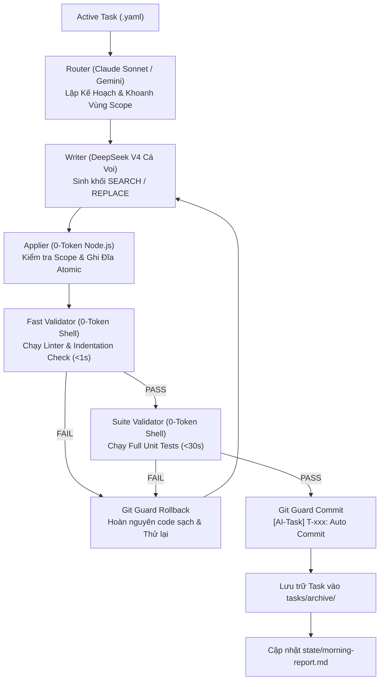

# 🤖 Minimal Agent Orchestration Standard (v2.1 Architecture)

[](LICENSE)
[](https://nodejs.org/)
[](#)
[](#)
[](#)

> **Bộ khung điều phối đội ngũ Đa Agent (Multi-Agent Squad) cắm-là-chạy (Plug-and-Play) dành cho mọi dự án phần mềm.**  
> Chạy xuyên suốt qua đêm, tự động sửa lỗi, kiểm tra an toàn mã nguồn, rollback khi test fail và báo cáo tổng kết buổi sáng — **tối ưu chi phí và không lãng phí token**.

---

## 📖 Mục Lục
- [1. Triết Lý Thiết Kế & Nguyên Tắc Vận Hành](PHILOSOPHY.md)
- [2. Vấn Đề & Giải Pháp](#1-vấn-đề--giải-pháp)
- [3. Kiến Trúc Luồng Hoạt Động](#2-kiến-trúc-luồng-hoạt-động)
- [4. Cấu Trúc Thư Mục](#3-cấu-trúc-thư-mục)
- [5. Đội Hình Squad & Phân Vai](#4-đội-hình-squad--phân-vai)
- [6. Hướng Dẫn Sử Dụng Nhanh (Quickstart)](#5-hướng-dẫn-sử-dụng-nhanh-quickstart)
- [7. Cấu Hình Dự Án](#6-cấu-hình-dự-án)
- [8. Đặc Tả Kỹ Thuật (v2.1 Addendum)](OPERATIONAL_SPEC_V2.1.md)
- [9. Giấy Phép (License)](#8-giấy-phép-license)

---

## 1. Vấn Đề & Giải Pháp

| Vấn đề khi dùng AI code truyền thống | Giải pháp của Minimal Agent Framework |
| :--- | :--- |
| **Đốt token hai lần:** Dùng LLM chỉ để đọc code của LLM khác rồi viết lại ra file. | **Zero LLM Pass-Through:** Writer chỉ sinh khối diff `SEARCH/REPLACE`, công cụ Node.js 0-token ghi thẳng xuống đĩa. |
| **Code lười biếng (`// ... existing code ...`):** AI viết tắt làm bay màu logic cũ. | **Anti-Lazy Regex Guard:** Phát hiện chuỗi tắt và reject lập tức trước khi ghi đĩa. |
| **Kẹt vòng lặp sửa lỗi qua đêm:** AI sửa cùng 1 lỗi liên tục gây cháy tiền API. | **SHA-1 Error Hashing:** Băm hash lỗi; nếu lỗi trùng lặp $\ge 2$ lần, lập tức ngắt task và chuyển sang task kế tiếp. |
| **Làm vỡ môi trường:** Code sai gây crash không hoàn tác được. | **Git Guard Rollback:** Tự động `git checkout -- .` ngay khi test fail, giữ repo luôn sạch sẽ. |

---

## 2. Kiến Trúc Luồng Hoạt Động



---

## 3. Cấu Trúc Thư Mục

```text
agent-team/
├── .gitattributes             # Chuẩn hóa EOL (LF) chống diff ảo trên Windows
├── .gitignore                 # Bỏ qua node_modules và file lock
├── package.json               # Script chạy và phụ thuộc Node.js (yaml)
├── README.md                  # Tài liệu hướng dẫn này
├── BLUEPRINT.md               # Bản đặc tả kỹ thuật chi tiết v2.0
├── config/
│   ├── team.yaml              # Khai báo Provider (9Router), Role và Model
│   ├── project.yaml           # Cấu hình lệnh test shell và thư mục an toàn của dự án
│   └── policy.yaml            # Trần token/chi phí per task, trần retry, scope guard
├── roles/
│   ├── router.md              # System prompt cho Router
│   ├── writer.md              # System prompt ép chuẩn SEARCH/REPLACE cho Writer
│   └── reviewer.md            # System prompt tiêu chí review cho Reviewer
├── state/
│   ├── task-state.schema.json # JSON Schema chuẩn hóa state
│   ├── task-state.json        # File trạng thái ghi atomic (.tmp + rename)
│   └── morning-report.md      # Báo cáo tổng kết buổi sáng cho Sếp
├── tasks/
│   ├── task-template.yaml     # Mẫu file task mới
│   ├── active/                # Thư mục chứa các task đang xếp hàng chạy
│   └── archive/               # Thư mục lưu các task đã hoàn thành
└── scripts/
    ├── applier.mjs            # 0-token parser SEARCH/REPLACE, ghi atomic
    ├── git-guard.mjs          # 0-token snapshot, rollback an toàn, auto commit
    ├── validator.mjs          # 0-token chạy test shell, hash sha1 chống lặp vô tận
    └── orchestrator.mjs       # Bộ điều phối trung tâm độc lập, có lock file
```

---

## 4. Phân Vai Đội Ngũ (Model Agnostic Architecture)

Bộ khung được thiết kế theo kiến trúc **Model-Agnostic** (linh hoạt hoán đổi bất kỳ LLM nào thông qua cổng OpenAI-compatible như 9Router, Ollama, OpenRouter, vLLM):

1. **Strategic Tech Lead & Architect (Tier-1 Reasoning Engine)**
   - *Model khuyến nghị:* Claude Opus / Claude 3.7 / GPT-4o
   - *Nhiệm vụ:* Thẩm định kiến trúc, phê duyệt kế hoạch (Plan Approval), phân tích các ca edge-case phức tạp và review diff.
2. **Senior UI/UX Designer & Planner (Context & Creative Engine)**
   - *Model khuyến nghị:* Claude Sonnet / Gemini 1.5 Pro
   - *Nhiệm vụ:* Bóc tách yêu cầu người dùng thành các task nhỏ, định hình thẩm mỹ giao diện và khoanh vùng `task.scope`.
3. **Core Backend Engineer (High-Throughput Coding Engine)**
   - *Model khuyến nghị:* DeepSeek V3 / DeepSeek V4 / Qwen 2.5 Coder
   - *Nhiệm vụ:* Cỗ máy sinh code tốc độ cao, chi phí cực thấp, chỉ tập trung xuất khối `SEARCH/REPLACE` chuẩn xác từng dòng.
4. **Squad Coordinator & Automated Gatekeeper (Deterministic Runner)**
   - *Thành phần:* Antigravity Agent / Local Node.js Engine
   - *Nhiệm vụ:* Giữ nhịp điều phối, kiểm soát chuẩn thụt lề (TAB/Space), ép chạy kiểm thử tự động 100% trước khi commit.

---

## 5. Hướng Dẫn Sử Dụng Nhanh (Quickstart)

### Bước 1: Copy thư mục `agent-team/` vào dự án của bạn
Đặt thư mục `agent-team/` ngay tại root của bất kỳ repository nào:
```bash
cp -r agent-team /path/to/your-project/
cd /path/to/your-project/agent-team
npm install
```

### Bước 2: Cập nhật `config/project.yaml`
Khai báo lệnh kiểm tra của dự án bạn (chạy bằng shell thuần túy, 0 token):
```yaml
project:
  id: "my-project"
  allowed_dirs:
    - "src/"
    - "tests/"
  validation:
    fast_checks:
      - name: "Lint Check"
        run: "python -m py_compile src/**/*.py"
    suite_checks:
      - name: "Unit Tests"
        run: "pytest tests/"
```

### Bước 3: Tạo Task trong `tasks/active/`
Tạo file `tasks/active/T-001.yaml`:
```yaml
task:
  id: "T-001"
  title: "Bổ sung API kiểm tra sức khỏe hệ thống"
  goal: "Thêm endpoint /healthz trả về JSON { status: 'ok' } trong src/server.py"
  scope:
    - "src/server.py"
    - "tests/test_health.py"
```

### Bước 4: Khởi động cỗ máy tự chạy
```bash
npm start
```
*Để chạy qua đêm trên server hoặc máy cá nhân:*
```bash
npx pm2 start scripts/orchestrator.mjs --name "agent-orchestrator"
```
Sáng hôm sau, mở file `state/morning-report.md` để xem danh sách toàn bộ task đã xong kèm commit hash tương ứng!

---

## 6. Cấu Hình Dự Án

### `config/policy.yaml` (Bảo Vệ Ngân Sách)
```yaml
policy:
  scope_control:
    max_files_per_task: 5
    strict_scope_enforcement: true
  retry_and_escalation:
    max_retries_per_task: 3
    abort_on_identical_error_count: 2 # Chặn lặp vô tận
    token_budget_per_task: 150000     # Trần chi phí bảo vệ
  git_hygiene:
    rollback_on_validation_fail: true # Tự rollback khi fail test
    auto_commit_on_done: true
```

---

## 7. Bản Đặc Tả Kỹ Thuật Chi Tiết

Xem toàn bộ nội dung bản đặc tả kiến trúc tại [BLUEPRINT.md](BLUEPRINT.md).

---

## 8. Giấy Phép (License)

Dự án phát hành theo giấy phép [MIT License](LICENSE). Tự do sử dụng, chỉnh sửa và tích hợp vào mọi dự án thương mại hoặc cá nhân.
