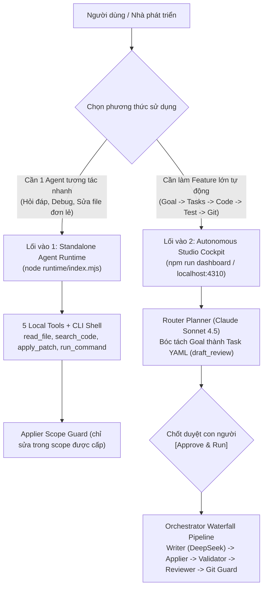

# 🤖 Minimal Agent Orchestration & Runtime Standard (v3.0)

[](LICENSE)
[](https://nodejs.org/)
[](#)
[](#)
[](#)

> **Bộ khung Đa Tác Tử (Multi-Agent Squad) & Môi Trường Tác Tử Độc Lập (Standalone Agent Runtime v3.0) dành cho các dự án phần mềm.**  
> Tích hợp 2 lối vào linh hoạt: Gọi một Agent trực tiếp có Đôi Tay (Tools), Đôi Mắt (Vision Base64), Đôi Chân (CLI Sandbox), Trí Nhớ (Sessions) HOẶC chạy cả quy trình Waterfall tự động theo Task Contract qua Web Cockpit / Terminal.

---

## ⚡ Quickstart 30 Giây (Dành cho Người Mới)

### 1. Cài đặt & Chạy tự kiểm định
Clone vào dự án phần mềm của bạn và chạy bộ test tự kiểm 0-token:
```bash
git clone https://github.com/QuanHuynh123/minimal-agent-orchestrator.git agent-team
cd agent-team
npm install
npm test
```
*(Nếu cả 3 bộ test Applier, Runtime v3 và Cockpit đều báo PASS 100% $\rightarrow$ Hệ thống đã sẵn sàng!)*

### 2. Cấu hình tối thiểu 1 Model (1-Model Minimal Setup)
Mở file [`config/team.yaml`](config/team.yaml) và điền endpoint cổng LLM (hỗ trợ mọi nhà cung cấp chuẩn OpenAI-compatible như 9Router, OpenRouter, DeepSeek, Ollama, vLLM):
```yaml
providers:
  local_9router:
    base_url: "http://127.0.0.1:20128/v1"
    api_key_env: "NINE_ROUTER_API_KEY"  # Hoặc đặt biến môi trường NINE_ROUTER_API_KEY
roles:
  writer:
    model: "deepseek-ai/deepseek-v4.1-flash-1017" # Điền model của bạn
```
*(Chỉ cần cấu hình duy nhất model cho `writer`, các role khác sẽ tự động kế thừa nếu bạn chưa bật multi-model).*

---

## 🚪 Hai Lối Vào Kiến Trúc (Dual-Entry Architecture)

> **Quy tắc phân định cốt lõi:**  
> **"Runtime có thể sửa file qua applier trong scope được cấp; Orchestrator là một workflow dùng runtime để chạy task theo quy trình."**



| Tiêu chí | Lối vào 1: Standalone Agent Runtime | Lối vào 2: Autonomous Squad Orchestrator |
| :--- | :--- | :--- |
| **Lệnh chạy** | `npm run agent -- --role writer --prompt "..."` | `npm run dashboard` (Web) hoặc `npm start` (CLI) |
| **Bản chất** | **Agent đơn lẻ tương tác (Interactive Single Agent)** | **Quy trình thác nước tự động theo lô (Batch Workflow)** |
| **Giao diện** | CLI Terminal hoặc nhúng API (`import { runAgent }`) | Bàn điều khiển Web Cockpit (`http://127.0.0.1:4310`) |
| **Năng lực** | Có Đôi Mắt (Vision Base64), Đôi Tay (Tools), Chân CLI, Trí Nhớ Session. | Điều phối cả đội ngũ AI (Router $\rightarrow$ Writer $\rightarrow$ Validator $\rightarrow$ Reviewer). |
| **Quyền ghi mã nguồn** | Sửa file qua `applier` **chỉ trong `scope` được chỉ định**. | Sửa file qua `applier` kèm **tự động kiểm thử, tự sửa lỗi retry và commit Git**. |
| **Khi nào nên dùng?** | Khi muốn chat/hỏi nhanh về repo, chẩn đoán bug, hoặc cho Agent sửa 1 file cụ thể. | Khi cần giao một tính năng lớn, muốn AI tự lập kế hoạch và tự động hoàn thành 100%. |

---

## 🛠️ Các Lệnh Vận Hành Cốt Lõi (`package.json`)

| Lệnh | File thực thi | Mô tả chức năng |
| :--- | :--- | :--- |
| `npm run dashboard` | `scripts/dashboard.mjs` | **Mở Web Cockpit Studio tại `http://127.0.0.1:4310`**. Bàn điều khiển AI một chạm (gõ ý tưởng $\rightarrow$ xem kế hoạch $\rightarrow$ bấm duyệt chạy ngầm), bảo mật Zero-Trust CSRF. |
| `npm run plan -- "<goal>"` | `scripts/goal-planner.mjs` | **AI Architect Decomposer:** Dùng Router Agent đọc cấu trúc code thật, bóc tách Goal thành 1–3 file Task Contract YAML (`status: draft_review`). |
| `npm run agent` | `runtime/index.mjs` | **Chạy Standalone Agent:** Chạy 1 Agent độc lập với vòng lặp Bounded Tool Loop ($\le 4$ turns), hỗ trợ đính kèm ảnh `--image` và file `--file`. |
| `npm start` | `scripts/orchestrator.mjs` | **Chạy Orchestrator Pipeline:** Quét và thực thi toàn bộ các task có `status: "ready"` trong `tasks/active/`. |
| `npm test` | Test runner tổng hợp | **Chạy toàn bộ Unit Tests:** Kiểm tra Applier v2.1, Runtime v3.0 và Web Cockpit CSRF Security. |
| `npm run validate` | `scripts/validator.mjs` | **Chạy 0-Token Validator:** Kiểm tra chuẩn thụt lề TAB và bộ test của dự án. |

---

## 📁 Cấu Trúc Thư Mục Chuẩn v3.0

```text
agent-team/
├── ONBOARDING.md              # Cẩm nang khởi tạo tối thiểu và chỉ thị cho AI Agent
├── package.json               # Các lệnh vận hành (dashboard, plan, agent, start, test)
├── README.md                  # Tài liệu kiến trúc và hướng dẫn sử dụng
├── PHILOSOPHY.md              # Triết lý thiết kế 0-token và bảo vệ working tree
├── BLUEPRINT.md               # Đặc tả chi tiết cơ chế bảo vệ và luồng dữ liệu
├── config/
│   ├── team.yaml              # Cấu hình Provider (9Router/OpenAI), Role và Model
│   ├── project.yaml           # Ranh giới dự án (allowed_dirs, protected_files, test commands)
│   └── policy.yaml            # Chính sách bảo vệ, trần token/retry và Risk Gates
├── roles/
│   ├── router.md              # System prompt và JSON contract cho Router Agent
│   ├── writer.md              # System prompt ép chuẩn SEARCH/REPLACE cho Writer
│   └── reviewer.md            # System prompt và 4 tiêu chí Rubric cho Reviewer
├── runtime/                   # Agent Runtime Core v3.0 (Độc lập, có Tools & Trí nhớ)
│   ├── index.mjs              # CLI & Programmatic API (runAgent)
│   ├── provider-gateway.mjs   # Capability Matrix, HTTP Gateway & Dual Tool Parser
│   ├── context-adapter.mjs    # Đôi Mắt: Mã hóa ảnh Vision Multimodal & File text
│   ├── tool-runtime.mjs       # Đôi Tay: 5 Local Tools + CLI Shell Sandbox (Windows PowerShell)
│   └── session-store.mjs      # Trí Nhớ: Persistent Sessions & Token Diet Compaction
├── state/
│   ├── task-state.json        # Trạng thái vận hành ghi atomic (.tmp + rename)
│   ├── morning-report.md      # Báo cáo tổng hợp tự động sau mỗi phiên chạy
│   └── sessions/              # Lưu trữ lịch sử đối thoại và tool receipts (.json)
├── tasks/
│   ├── task-template.yaml     # Mẫu khởi tạo task YAML chuẩn
│   ├── active/                # Hàng đợi các task đang chờ duyệt (draft_review) hoặc sẵn sàng (ready)
│   └── archive/               # Lưu trữ các task đã hoàn thành (done / blocked / failed)
├── ui/
│   └── index.html             # Giao diện Web Cockpit Studio v3.0 (Tailwind + Bento Grid)
└── scripts/
    ├── goal-planner.mjs       # Bộ bóc tách Goal tự nhiên thành Task YAML nguyên tử
    ├── dashboard.mjs          # Máy chủ Web Cockpit (:4310) bảo mật CSRF & Lock Guard
    ├── orchestrator.mjs       # Bộ điều phối trung tâm (Waterfall Mode-Based Engine)
    ├── applier.mjs            # Bộ áp bản vá an toàn 8 bước (In-Memory Simulation)
    ├── git-guard.mjs          # Quản lý Scoped Snapshot, Diff, Rollback và Scoped Commit
    ├── validator.mjs          # Bộ chạy kiểm thử 0-token, diệt cây tiến trình treo
    ├── test-applier-v2.1.mjs  # Unit test kiểm định Applier & Orchestrator
    ├── test-runtime-v3.mjs    # Unit test kiểm định Agent Runtime v3.0
    └── test-cockpit.mjs       # Unit test kiểm định Cockpit API & CSRF Security
```

---

## 🔒 4 Rào Chắn An Toàn Bất Biến (Security Invariants)

1. **Zero-Token Guardrails:** Việc áp mã nguồn (`applier.mjs`), chạy test (`validator.mjs`), và commit Git (`git-guard.mjs`) hoàn toàn do mã Node.js tất định thực thi — không tốn thêm bất kỳ 1 token LLM nào.
2. **Strict Scope Isolation:** Cả Runtime lẫn Orchestrator đều bị chặn cứng: Tuyệt đối không được đọc hoặc ghi file nằm ngoài danh sách `scope` và ngoài `project.allowed_dirs`.
3. **Anti-Hallucination & Anti-Lazy Code:** Chặn đứng các câu viết tắt kiểu `// ... existing code ...`; bắt buộc đoạn `SEARCH` phải khớp duy nhất 1 lần trong file trước khi chạm ổ cứng.
4. **Zero-Trust Localhost:** Cổng Dashboard `:4310` được bảo vệ bằng CSRF Token ngẫu nhiên và Origin Guard, ngăn chặn 100% các cuộc tấn công ngầm từ website bên ngoài.

---

## 📄 Giấy Phép (License)
Phát hành theo giấy phép [MIT License](LICENSE).
