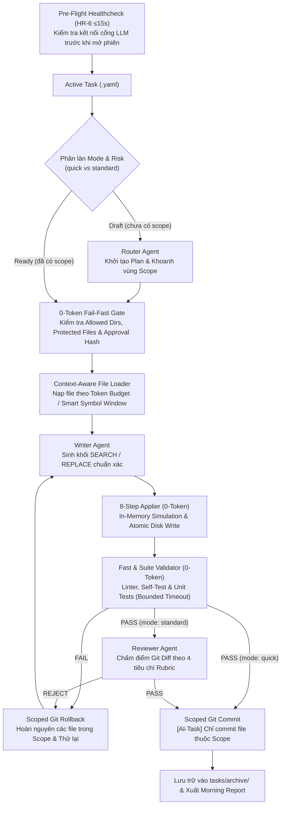

# 🤖 Minimal Agent Orchestration Standard (v2.1 Architecture)

[](LICENSE)
[](https://nodejs.org/)
[](#)
[](#)
[](#)

> **Bộ khung điều phối Đa Tác Tử (Multi-Agent Orchestration Framework) theo kiến trúc Mode-Based & Plug-and-Play dành cho các dự án phần mềm.**  
> Kết hợp linh hoạt giữa làm việc tương tác trên IDE (Direct/Quick Mode) và chạy tự động theo lô (Unattended Batch Mode) — cưỡng chế ranh giới phạm vi (Scope Isolation), kiểm thử 0-token, tự động hoàn nguyên khi lỗi và bảo vệ ngân sách token.

---

## 👋 Mới tải về? Quy trình Onboarding Chuẩn (`Chat = Read/Plan`, `CLI Runner = Write`)

> **Nguyên tắc kiến trúc cốt lõi:**
> - **IDE Chat là Read-Only mặc định** đối với mã nguồn dự án (chỉ đọc hiểu repo, đề xuất cấu hình và soạn thảo Task Contract `.yaml`).
> - **Mọi thao tác ghi mã nguồn vào dự án phải đi qua CLI Runner (`orchestrator.mjs` $\rightarrow$ `applier.mjs`)** để được kiểm soát `scope` và `protected_files`.

1. **Tại CLI Terminal:** Clone `agent-team` vào dự án của bạn và chạy tự kiểm:
   ```bash
   git clone https://github.com/QuanHuynh123/minimal-agent-orchestrator.git agent-team
   cd agent-team && npm install && npm test
   ```
2. **Tại IDE Chat (Cline, Antigravity, Cursor, Claude Code...):** Nhờ AI khảo sát và soạn bản nháp cấu hình/task bằng câu lệnh:
   ```text
   Hãy đọc file agent-team/ONBOARDING.md. Ở chế độ Read-Only (không trực tiếp sửa code dự án hay ghi đè protected_files), hãy khảo sát cấu trúc dự án hiện tại của tôi và đề xuất cấu hình config/project.yaml cùng Task Contract mẫu để tôi duyệt.
   ```
3. **Tại CLI Terminal:** Sau khi duyệt cấu hình và đặt task vào `tasks/active/`, chạy `npm start` từ CLI để hệ thống thực thi, kiểm thử và commit an toàn. Xem chi tiết tại **[`ONBOARDING.md`](ONBOARDING.md)**.

---

## 📖 Mục Lục
- [0. Hướng Dẫn Khởi Tạo Tự Động Cho AI Agent (`ONBOARDING.md`)](ONBOARDING.md)
- [1. Triết Lý Thiết Kế & Nguyên Tắc Vận Hành](PHILOSOPHY.md)
- [2. Vấn Đề & Giải Pháp](#1-vấn-đề--giải-pháp)
- [3. Kiến Trúc Phân Làn (Mode-Based Architecture)](#2-kiến-trúc-phân-làn-mode-based-architecture)
- [4. Cấu Trúc Thư Mục](#3-cấu-trúc-thư-mục)
- [5. Phân Vai Đội Ngũ (Model-Agnostic)](#4-phân-vai-đội-ngũ-model-agnostic-architecture)
- [6. Hướng Dẫn Sử Dụng Nhanh (Quickstart)](#5-hướng-dẫn-sử-dụng-nhanh-quickstart)
- [7. Cấu Hình & Chính Sách Bảo Vệ](#6-cấu-hình-dự-án)
- [8. Đặc Tả Kỹ Thuật (v2.1 Addendum)](OPERATIONAL_SPEC_V2.1.md)
- [9. Giấy Phép (License)](#8-giấy-phép-license)

---

## 1. Vấn Đề & Giải Pháp

| Vấn đề khi dùng AI code truyền thống | Giải pháp của Minimal Agent Framework (v2.1) |
| :--- | :--- |
| **Đốt token hai lần:** Dùng LLM chỉ để đọc code của LLM khác rồi viết lại ra file. | **Zero LLM Pass-Through:** Writer chỉ sinh khối diff `SEARCH/REPLACE`, công cụ Node.js (`applier.mjs`) kiểm tra an toàn và ghi thẳng xuống đĩa. |
| **Writer bị mù ngữ cảnh hoặc tràn token với file lớn:** Cắt file cứng nhắc làm mất đoạn code cần sửa. | **Context-Aware File Loader:** Tự động nạp nguyên file theo ngân sách token hoặc cắt cửa sổ ngữ cảnh ($\pm 80$ dòng) quanh các hàm/symbol mục tiêu. |
| **Code lười biếng (`// ... existing code ...`):** AI viết tắt làm mất logic cũ. | **Anti-Lazy Regex Guard & Single-Match Check:** Phát hiện chuỗi viết tắt và bắt buộc khối `SEARCH` khớp duy nhất 1 lần trong bộ nhớ trước khi chạm ổ cứng. |
| **Kẹt vòng lặp sửa lỗi vô tận:** AI lặp lại cùng 1 lỗi hoặc treo kết nối mạng. | **Normalized SHA-1 Error Hash & HR-1..7 Guardrails:** Chuẩn hóa chuỗi lỗi trước khi băm SHA-1; ngắt ngay nếu lặp lỗi $\ge 2$ lần; ép timeout cho mọi lệnh mạng và tiến trình con. |
| **Làm bẩn Git Working Tree:** Commit nhầm file đang sửa dở bên ngoài task. | **Scoped Git Hygiene:** Chỉ kiểm tra, rollback và commit đúng danh sách file thuộc phạm vi (`scope` + `scope_expansions`) của task. |

---

## 2. Kiến Trúc Phân Làn (Mode-Based Architecture)

Hệ thống phân tầng thực thi dựa trên độ phức tạp và mức độ rủi ro của tác vụ thay vì áp đặt một quy trình nặng nề duy nhất:

- **Làn `direct` (Read-Only / Trivial Inspection):** Dành cho tra cứu, chẩn đoán lỗi, đọc hiểu kiến trúc và soạn thảo Task Contract trên IDE Chat mà không tự ý sửa mã nguồn dự án.
- **Làn `quick` (Small Write — Mặc định khi $\le 3$ files, rủi ro `low`):** Thực thi qua CLI Runner (`orchestrator.mjs`), bỏ qua bước lập kế hoạch/review trung gian; chạy thẳng **Context Loader $\rightarrow$ Writer $\rightarrow$ 8-Step Applier $\rightarrow$ 0-Token Validator $\rightarrow$ Scoped Commit**.
- **Làn `standard` (Complex / Cross-Scope / High-Risk):** Thực thi qua CLI Runner với đầy đủ **Router Planner $\rightarrow$ Approval Gate (`scope_hash`) $\rightarrow$ Writer $\rightarrow$ Applier $\rightarrow$ Validator $\rightarrow$ LLM Reviewer Rubric**.



---

## 3. Cấu Trúc Thư Mục

```text
agent-team/
├── ONBOARDING.md              # Playbook khởi tạo & vận hành tự động dành cho AI Agent đọc
├── .gitattributes             # Chuẩn hóa EOL (LF) chống diff ảo đa nền tảng
├── .gitignore                 # Bỏ qua node_modules và file lock
├── package.json               # Script vận hành và phụ thuộc tối giản (yaml)
├── README.md                  # Tài liệu tổng quan và hướng dẫn sử dụng
├── PHILOSOPHY.md              # Triết lý thiết kế và nguyên tắc cốt lõi
├── BLUEPRINT.md               # Bản đặc tả kiến trúc chuẩn
├── OPERATIONAL_SPEC_V2.1.md   # Phụ lục đặc tả kỹ thuật và quy tắc an toàn v2.1
├── config/
│   ├── team.yaml              # Khai báo Provider (OpenAI-compatible / 9Router), Role và Model
│   ├── project.yaml           # Cấu hình repo_root động, allowed_dirs, protected_files và lệnh test
│   └── policy.yaml            # Cấu hình Mode-Based Policy, trần token/retry và Execution Guardrails
├── roles/
│   ├── router.md              # System prompt và JSON contract cho Router
│   ├── writer.md              # System prompt ép chuẩn SEARCH/REPLACE cho Writer
│   └── reviewer.md            # System prompt và 4 tiêu chí Rubric cho Reviewer
├── state/
│   ├── task-state.schema.json # JSON Schema chuẩn hóa trạng thái task (v2.1)
│   ├── task-state.json        # Trạng thái vận hành ghi atomic (.tmp + rename)
│   └── morning-report.md      # Báo cáo tổng hợp tự động sau mỗi phiên chạy
├── tasks/
│   ├── task-template.yaml     # Mẫu khởi tạo task chuẩn v2.1
│   ├── active/                # Hàng đợi các task đang chờ thực thi
│   └── archive/               # Lưu trữ các task đã hoàn tất (done / blocked / failed)
└── scripts/
    ├── applier.mjs            # 8-Step Deterministic Applier, In-Memory Simulation & Atomic Write
    ├── git-guard.mjs          # Quản lý Scoped Snapshot, Diff, Rollback và Commit
    ├── validator.mjs          # 0-Token Test Runner, Process-Tree Kill, Normalized Hash & Scope Audit
    ├── orchestrator.mjs       # Bộ điều phối trung tâm (Mode-Based Engine, Healthcheck, Stale Lock Recovery)
    └── test-applier-v2.1.mjs  # Bộ unit test tự kiểm định toàn bộ cơ chế bảo vệ v2.1
```

---

## 4. Phân Vai Đội Ngũ (Model-Agnostic Architecture)

Bộ khung tương thích với mọi cổng LLM chuẩn OpenAI-compatible (`9Router`, `OpenRouter`, `LiteLLM`, `Ollama`, `vLLM`):

1. **Reviewer & Architecture Gatekeeper (Tier-1 Reasoning Engine)**
   - *Model khuyến nghị:* Claude Opus / Claude Sonnet / GPT-4o
   - *Nhiệm vụ:* Thẩm định bản `git diff` thực tế ở chế độ `standard` theo 4 tiêu chí nhị phân (`correctness`, `safety`, `scope_adherence`, `testability`).
2. **Router & Task Planner (Context & Triage Engine)**
   - *Model khuyến nghị:* Claude Sonnet / Gemini Pro
   - *Nhiệm vụ:* Phân tích yêu cầu ở trạng thái `draft`, chia nhỏ kế hoạch thực thi và khoanh vùng `task.scope`.
3. **Core Code Writer (High-Throughput Coding Engine)**
   - *Model khuyến nghị:* DeepSeek V3/V4 / Qwen 2.5 Coder / Claude Sonnet
   - *Nhiệm vụ:* Sinh bản vá theo định dạng `<<<<<<< SEARCH ... ======= ... >>>>>>> REPLACE` khớp chính xác với ngữ cảnh file.
4. **Deterministic Gatekeeper (0-Token System Runner)**
   - *Thành phần:* `applier.mjs`, `validator.mjs`, `git-guard.mjs`
   - *Nhiệm vụ:* Cưỡng chế ranh giới thư mục, chặn sửa file nhạy cảm, kiểm tra thụt lề/unit test và quản lý Git an toàn không tốn token.

---

## 5. Hướng Dẫn Sử Dụng Nhanh (Quickstart — CLI-First Workflow)

### Bước 1: Cài đặt & Dùng IDE Chat để Soạn thảo Cấu hình (Read-Only)
1. Clone `agent-team` vào thư mục gốc dự án của bạn và chạy bộ tự kiểm từ **CLI Terminal**:
   ```bash
   git clone https://github.com/QuanHuynh123/minimal-agent-orchestrator.git agent-team
   cd agent-team && npm install && npm test
   ```
2. Bạn vẫn có thể giao việc bằng ngôn ngữ tự nhiên trên **IDE Chat (Cline / Antigravity / Cursor)**, nhưng **write vào repo phải thông qua `orchestrator` / `applier`**; chế độ Chat chỉ dùng để đọc, phân tích, đề xuất cấu hình và tạo Task Contract (xem **[`ONBOARDING.md`](ONBOARDING.md)**).

### Bước 2: Cập nhật `config/project.yaml`
Khai báo đường dẫn gốc dự án (`repo_root`), danh sách thư mục cho phép và lệnh kiểm thử 0-token:
```yaml
project:
  id: "my-application"
  language: "python"
  repo_root: "../"
  allowed_dirs:
    - "src/"
    - "tests/"
  protected_files:
    - "**/.env*"
    - "package.json"
    - "requirements.txt"
    - "agent-team/scripts/**"
    - "agent-team/config/**"
  validation:
    fast_checks:
      - name: "syntax_and_lint"
        run: "python -m unittest tests/test_indentation.py"
        timeout_sec: 15
    suite_checks:
      - name: "unit_test_suite"
        run: "python -m unittest discover -s tests -v"
        timeout_sec: 60
```

### Bước 3: Tạo Task trong `tasks/active/`
Tạo file `tasks/active/T-2026-10-31-001.yaml` theo mẫu chuẩn:
```yaml
task_id: "T-2026-10-31-001"
project_id: "my-application"
title: "Bổ sung API kiểm tra sức khỏe hệ thống"
mode: "quick" # "direct" | "quick" | "standard"
status: "ready"
owner: "writer"
goal: "Thêm hàm check_health() trả về dict {'status': 'ok'} trong src/health.py"
scope:
  - "src/health.py"
  - "tests/test_health.py"
risk_level: "low"
allow_scope_expansion: false
acceptance_criteria:
  - "Hàm check_health() trả về {'status': 'ok'}"
  - "Unit test trong tests/test_health.py chạy PASS 100%"
```

### Bước 4: Thực thi & Kiểm định từ CLI Terminal
- **Chạy kiểm định cấu hình & phạm vi từ CLI:**
  ```bash
  node scripts/test-applier-v2.1.mjs
  node scripts/validator.mjs fast --scope src/health.py,tests/test_health.py
  ```
- **Chạy hàng đợi Task qua Orchestrator Runner (Write via Applier):**
  ```bash
  npm start
  ```
- **Mở giao diện quan sát trực tiếp (Bento Dark Live Monitor tại `http://127.0.0.1:4310`):**
  ```bash
  npm run dashboard
  ```

---

## 6. Cấu Hình Dự Án (`config/policy.yaml`)

```yaml
policy:
  scope_control:
    max_files_per_task: 5
    max_scope_increase: 1
    allow_new_files: true
    new_files_only_in_scope: true
    strict_scope_enforcement: true
  task_modes:
    quick:
      max_files: 1
      max_runtime_sec: 30
      skip_router_and_reviewer: true
    standard:
      max_runtime_sec: 300
      skip_router_and_reviewer: false
  retry_and_escalation:
    max_retries_per_task: 3
    abort_on_identical_error_count: 2
    token_budget_per_task: 150000
    night_token_budget_total: 3000000
```

---

## 7. Tài Liệu Kiến Trúc Chi Tiết

- [Triết Lý Thiết Kế & Nguyên Tắc Vận Hành (`PHILOSOPHY.md`)](PHILOSOPHY.md)
- [Đặc Tả Kiến Trúc Nền Tảng (`BLUEPRINT.md`)](BLUEPRINT.md)
- [Đặc Tả Vận Hành & Chốt Chặn An Toàn v2.1 (`OPERATIONAL_SPEC_V2.1.md`)](OPERATIONAL_SPEC_V2.1.md)

---

## 8. Giấy Phép (License)

Dự án được phát hành theo giấy phép [MIT License](LICENSE).
