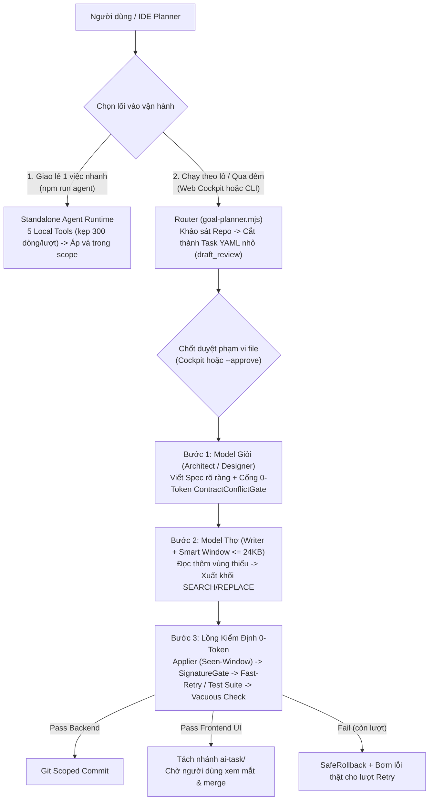

# 🤖 Minimal Agent Orchestrator & Runtime (v3.1)

[](LICENSE)
[](https://nodejs.org/)
[](#)
[](#)
[](#)

> **Bộ khung điều phối AI gọn nhẹ, trung lập dự án (Mini-Orchestrator & Standalone Agent Runtime)** — sinh ra để tận dụng các model AI giá rẻ / miễn phí qua cổng `9router` (hoặc bất kỳ endpoint OpenAI-compatible nào) chạy tự động nhiều task (kể cả treo máy qua đêm) mà **không làm nát codebase**.

---

## 🎯 Triết Lý Thiết Kế (Đọc Trước — Dành Cho Cả Người Dùng Lẫn AI Agent)

1. **Tại sao cần Mini-Orchestrator này?**
   - Các model AI giá rẻ / miễn phí có nhược điểm cố hữu khi làm việc trên dự án thật: nhớ ngắn, tự bịa tên hàm ngoài phạm vi, sửa chỗ A làm rách chỗ B, và càng tự retry càng phá hỏng dự án.
   - Ngược lại, nếu cố mô phỏng nguyên một "công ty phần mềm con người" nhiều tầng (`BA ➔ DA ➔ Architect ➔ BE ➔ FE ➔ QA`) giao tiếp tự do chỉ từ 1 câu prompt mơ hồ thì thông tin sẽ **tam sao thất bản**, đốt cạn token mà code vẫn lệch nhau.
2. **Mô hình hội tụ thực chiến (`Router ➔ [1 Model Giỏi + 1 Model Thợ] + Lồng Cứng 0-Token`):**
   - Vì các model giá rẻ khá yếu khi ôm việc lớn, nguyên tắc sống còn là **mỗi AI chỉ làm đúng 1 việc nhỏ trong một cái chuồng hẹp**:
     1. **`Router` (`scripts/goal-planner.mjs`):** Đọc sơ đồ AST của codebase, cắt mục tiêu thành các task nguyên tử thật nhỏ (`<= 2–3 file`, `< 150 dòng sửa`).
     2. **`1 Model Giỏi` (`Architect` hoặc `Designer`):** Đi trước 1 lượt để vạch rõ hợp đồng kỹ thuật, chữ ký hàm và điểm dễ sai cho con Thợ.
     3. **`1 Model Thợ` (`Writer`):** Chỉ làm đúng việc xuất khối `SEARCH/REPLACE` trong danh sách file `scope` được cấp (tận dụng Prefix KV-Cache qua các lượt đọc file).
     4. **`Lồng Kiểm Định 0-Token` (`applier` + `validator` + `git-guard`):** Toàn bộ bước áp code, chặn sửa ngoài vùng đã đọc (`not_in_seen_window`), kiểm tra chữ ký hàm AST (`SignatureGate`), chạy test nhanh, phát hiện test rỗng trên nhánh cha (`vacuous_test_check`), hoàn tác sạch (`safeRollback`) hoặc rẽ nhánh giao diện (`ai-task/<id>`) đều do code Node.js tất định thực thi — tốn `0` LLM token.
3. **Thước đo mục tiêu là `Task Success / Token` (Chống Over-Engineering & Không Tiết Kiệm Mù Quáng):**
   - Thời gian chạy hay vài xu quy đổi ảo không phải rào cản lớn vì hệ thống sinh ra để cày nền / qua đêm. Điều quyết định là **tỷ lệ hoàn thành task thật sự trên tổng token bỏ ra (`Task Success / Token`)** và **độ an toàn của repo**.
   - **Lưu ý dành cho các AI Agent đọc hoặc bảo trì kho mã này:** Đây là một **Mini-Orchestrator thực dụng**, KHÔNG phải nền tảng SaaS/Enterprise quy mô lớn. Đừng đề xuất các tầng trừu tượng/telemetry rườm rà, đừng tự ý bật chạy solo cho model yếu trên task phức tạp, và **đừng bóp nghẹt độ chi tiết bản vẽ của Model Giỏi** chỉ để tiết kiệm vài nghìn token khiến Model Thợ phải đoán mò.

---

## ⚡ Quickstart 60 Giây

### 1. Cài đặt & Kiểm thử Offline (Hỗ trợ cả chạy độc lập hoặc nhúng làm thư mục con)
```bash
# Cách A: Nhúng vào một dự án phần mềm sẵn có (thư mục agent-team/)
git clone https://github.com/QuanHuynh123/minimal-agent-orchestrator.git agent-team
cd agent-team

# (Hoặc Cách B: Clone độc lập để phát triển/thử nghiệm bộ khung)
# git clone https://github.com/QuanHuynh123/minimal-agent-orchestrator.git && cd minimal-agent-orchestrator

npm install
npm run test:offline
```
- **`npm run test:offline`:** Kiểm tra trọn vẹn toàn bộ lõi `Applier`, `Runtime`, `Smart Context Window`, `SignatureGate`, `Vacuous Test Check` hoàn toàn ngoại tuyến (`0` LLM token).
- **`npm test`:** Chạy thêm bộ kiểm tra máy chủ Web Cockpit & bảo mật CSRF.

### 2. Cấu hình Đội Hình Model (`config/team.yaml`)
Mở [`config/team.yaml`](config/team.yaml) và trỏ tới cổng OpenAI-compatible của bạn (9Router, OpenRouter, DeepSeek, Ollama, vLLM...):
```yaml
providers:
  local_9router:
    base_url: "http://127.0.0.1:20128/v1"
    api_key_env: "NINE_ROUTER_API_KEY"

roles:
  router:
    model: "ag/gemini-3.8-flash-medium"          # Cắt task nhanh 1 lượt
  architect:
    model: "ag/gemini-3.8-flash-medium"          # Model Giỏi vạch hợp đồng/spec
  designer:
    model: "ag/claude-sonnet-5-5"                # Model Giỏi đặc tả UI/DOM khi sửa giao diện
  writer:
    model: "deepseek-ai/deepseek-v4.1-flash-1017" # Model Thợ gõ code chính
    fallback_model: "ag/gemini-3.8-flash-medium"  # Dự phòng tự động khi model chính treo/timeout
```
*(Nếu bạn chỉ cấu hình duy nhất 1 model cho `writer`, hệ thống tự động thu gọn các bước phụ — Anti-Self-Play — để không bắt cùng 1 model tự viết spec cho chính mình đọc).*

### 3. Cấu hình Ranh giới & Lệnh Test Dự Án Đích (`config/policy.yaml`)
Mở [`config/policy.yaml`](config/policy.yaml) (hoặc tạo `config/policy.local.yaml` riêng cho máy cục bộ) để khai báo:
- `scope_control.allowed_dirs`: Các thư mục mã nguồn AI được phép đọc/sửa (vd. `src/`, `app/`, `tests/`).
- `scope_control.protected_files`: Các file nhạy cảm cấm tự ý sửa (`package.json`, `requirements.txt`, `.env*`).
- `validation.fast_checks` & `suite_checks`: Lệnh kiểm tra định dạng và chạy unit test của dự án đích (`npm test`, `pytest`, `go test`...).

---

## 🚪 Luồng Vận Hành Thực Tế & 2 Lối Vào



| Lệnh (`package.json`) | File thực thi | Công dụng thực tế |
| :--- | :--- | :--- |
| `npm run dashboard` | `scripts/dashboard.mjs` | Mở bàn điều khiển **Web Cockpit** cục bộ (mặc định `http://127.0.0.1:4310`, bảo vệ CSRF & khóa đơn tiến trình `.cockpit.lock`). |
| `npm run plan -- "<goal>"` | `scripts/goal-planner.mjs` | Dùng Router cắt yêu cầu thành các file Task YAML nguyên tử trong `tasks/active/` (`status: draft_review`). |
| `npm start` | `scripts/orchestrator.mjs` | Chạy tuần tự các task `status: "ready"` (thêm `-- --approve` hoặc `-y` để duyệt chạy luôn các task nháp). |
| `npm run agent` | `runtime/index.mjs` | Gọi độc lập 1 Agent kèm vòng lặp tool giới hạn lượt, hỗ trợ đính kèm ảnh `--image` và file `--file`. |
| `npm run validate` | `scripts/validator.mjs` | Chạy bộ kiểm định 0-token theo `config/policy.yaml`. |

---

## 📁 Cấu Trúc Thư Mục Chuẩn

```text
minimal-agent-orchestrator/
├── README.md                  # Giới thiệu triết lý thiết kế, kiến trúc và hướng dẫn nhanh
├── ONBOARDING.md              # Sổ tay khởi tạo cho Kỹ sư & Giao thức chỉ thị cho AI IDE Agent
├── RUNTIME_PAYLOAD_SPEC.md    # Đặc tả kỹ thuật KV-Cache prefix, 300-line clamp & 32k Epoch Compaction
├── config/
│   ├── team.yaml              # Cấu hình cổng LLM (9Router/OpenAI) và phân vai Model Giỏi / Model Thợ
│   └── policy.yaml            # Trần token, ranh giới thư mục, lệnh chạy test và cấu hình Cockpit
├── roles/                     # System prompt của 5 vai trò (router, architect, designer, writer, reviewer)
├── runtime/                   # Agent Runtime độc lập: giữ prefix KV-cache, Circuit-Breaker, Tree-Sitter RepoMap
├── scripts/
│   ├── goal-planner.mjs       # Router tách task 1-turn + kiểm tra phụ thuộc & chữ ký hàm (SignatureGate)
│   ├── orchestrator.mjs       # Vòng lặp điều phối chính (kèm các module con trong scripts/orchestrator/)
│   ├── dashboard.mjs          # Máy chủ Web Cockpit (:4310) bảo mật Zero-Trust CSRF
│   ├── applier.mjs            # Bộ áp SEARCH/REPLACE an toàn, chặn sửa mù ngoài vùng đã đọc (not_in_seen_window)
│   ├── validator.mjs          # Chạy fast-retry test, full suite và kiểm tra test rỗng trên nhánh cha
│   ├── git-guard.mjs          # SafeRollback bảo vệ file ngoài luồng, commit theo scope & rẽ nhánh UI ai-task/<id>
│   ├── lib/                   # Smart Context Window (<=24KB), chính sách chia bucket, lưu trạng thái nguyên tử
│   └── test-*.mjs             # Bộ unit test tự kiểm định ngoại tuyến 100% độc lập dự án (hermetic tests)
├── tasks/
│   ├── task-template.yaml     # Khuôn mẫu khởi tạo task YAML chuẩn
│   ├── active/                # Hàng đợi task đang chờ duyệt (draft_review / ready / awaiting_confirmation)
│   └── archive/               # Lưu trữ các task đã hoàn tất kèm thống kê bước chạy
├── state/                     # Trạng thái vận hành ghi nguyên tử, báo cáo sáng (morning-report) & telemetry
└── ui/                        # Giao diện Web Cockpit Studio (Vanilla HTML/CSS/JS chống XSS)
```

---

## 🔒 5 Chốt An Toàn Giữ Dự Án Không Nát Khi Chạy Đêm

1. **Chặn sửa mù (`Seen-Window Guard`):** Các file lớn được rút gọn qua `Smart Context Window (<= 24KB)`. Nếu Model Thợ định sửa vào vùng `[... OMITTED LINES ...]` mà chưa gọi `read_file` xem trước, `applier.mjs` từ chối ngay tại chỗ mà không tốn thời gian chạy test.
2. **Bảo vệ hàm đang dùng (`0-Token Signature & Deleted-Identifier Gate`):** Phân tích AST Tree-sitter trước/sau bản vá để chặn đứng việc tự ý đổi số lượng tham số hoặc xóa hàm đang được các file ngoài `scope` gọi tới.
3. **Phát hiện Test Rỗng (`Vacuous Test Check`):** Mọi bài unit test mới viết đều được chạy thử trên bản code gốc chưa vá (`git worktree` tách biệt); nếu chưa vá code mà test đã pass xanh thì bị gắn cờ cảnh báo ngay.
4. **Rẽ nhánh riêng cho Giao diện (`Frontend Branch Gate`):** Mọi thay đổi chạm vào file giao diện (`domain_patterns.frontend`) đều được commit vào nhánh riêng `ai-task/<id>` chờ người dùng kiểm tra bằng mắt trước khi gộp vào nhánh chính.
5. **Tự động nạp Quy ước Dự án Đích (`<project_conventions>`) & Khóa Đơn Tiến Trình:** Tự động đọc các quy tắc kỹ thuật từ `AGENTS.md` / `CLAUDE.md` / `RULES.md` của dự án chủ mà không xung đột quyền điều phối; bảo vệ bằng `.orchestrator.lock`, `.cockpit.lock` và CSRF Token trên localhost.

---

## 📄 Giấy Phép (License)
Phát hành theo giấy phép [MIT License](LICENSE).
