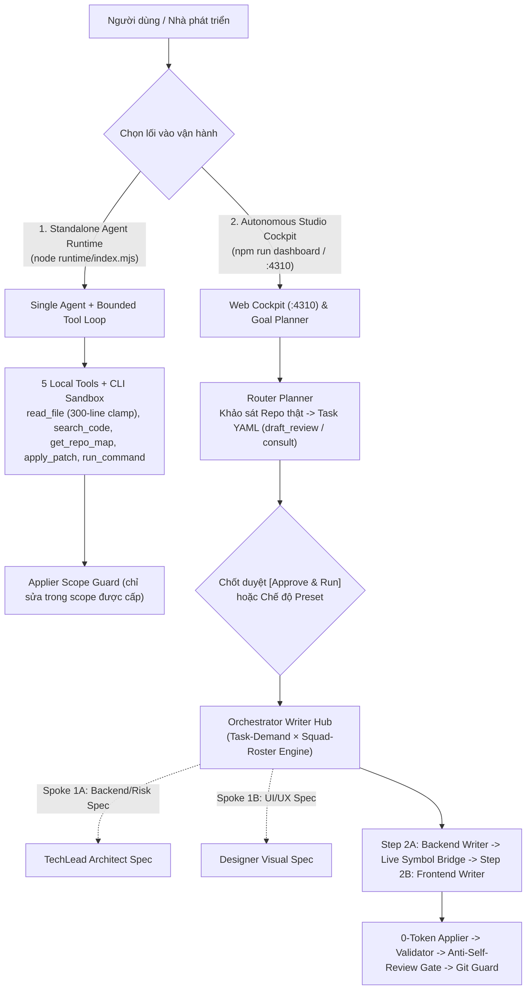

# 🤖 Minimal Agent Orchestration & Runtime Standard (v3.1)

[](LICENSE)
[](https://nodejs.org/)
[](#)
[](#)
[](#)

> **Bộ khung Đa Tác Tử (Multi-Agent Squad) & Môi Trường Tác Tử Độc Lập (Standalone Agent Runtime v3.1) dành cho mọi dự án phần mềm.**  
> Thiết kế theo **Kiến trúc Hình Sao (`Star Topology: Hub & Spoke`)** với bộ định tuyến thông minh **`Task-Demand × Squad-Roster` Engine**, chuẩn hóa Payload tương đương Antigravity IDE (`300`-line Bounded Read, `32k` Epoch Compaction, 3-Breakpoint Prompt Caching, `thought_signature` Passthrough) và tự động nạp quy ước dự án đích (`<project_conventions>`) không xung đột.

---

## ⚡ Quickstart 30 Giây (Dành cho Người Mới)

### 1. Cài đặt & Chạy tự kiểm định
Clone vào dự án phần mềm của bạn và chạy bộ test tự kiểm:
```bash
git clone https://github.com/QuanHuynh123/minimal-agent-orchestrator.git agent-team
cd agent-team
npm install
npm test
```
*   **Chạy kiểm thử Offline 0-Token:** Nếu chưa bật Router/LLM, chạy `npm run test:offline` để kiểm tra trọn vẹn 2 bộ lõi `Applier` và `Runtime v3` thuần túy ngoại tuyến.
*   **Chạy kiểm thử Đầy đủ:** `npm test` sẽ chạy thêm bộ kiểm tra Web Cockpit server & CSRF security (kèm 1 ping kết nối Router).

### 2. Cấu hình tối thiểu 1 Model (`config/team.yaml`)
Mở file [`config/team.yaml`](config/team.yaml) và điền endpoint cổng LLM (hỗ trợ mọi nhà cung cấp chuẩn OpenAI-compatible như 9Router, OpenRouter, DeepSeek, Ollama, vLLM):
```yaml
providers:
  local_9router:
    base_url: "http://127.0.0.1:20128/v1"
    api_key_env: "NINE_ROUTER_API_KEY"  # Hoặc đặt biến môi trường NINE_ROUTER_API_KEY
roles:
  writer:
    model: "deepseek-ai/deepseek-v4.1-flash-1017" # Điền model của bạn
```
*(Chỉ cần cấu hình duy nhất model cho `writer`, các role khác sẽ tự động kế thừa nếu bạn chưa bật multi-model).*

### 3. Cấu hình Ranh giới & Kiểm thử (`config/policy.yaml`)
Framework chuẩn hóa chỉ gồm **đúng 2 file cấu hình** trong `config/` (`team.yaml` và `policy.yaml`). Trước khi giao task cho codebase của bạn, hãy mở [`config/policy.yaml`](config/policy.yaml) để điều chỉnh:
- `scope_control.allowed_dirs`: Thư mục mã nguồn AI được phép sửa (ví dụ: `src/`, `lib/`).
- `scope_control.protected_files`: File nhạy cảm cấm sửa tự do (ví dụ: `package.json`, `.env*`).
- `validation.fast_checks`: Lệnh kiểm thử tự động của dự án bạn (ví dụ: `npm test` hoặc `pytest`).

---

## 🚪 Kiến Trúc Hình Sao & 2 Lối Vào Vận Hành (Star Topology & Dual-Entry)

> **Quy tắc phân định cốt lõi:**  
> **"Orchestrator (`Writer Hub`) là Trung Tâm Điều Phối duy nhất: các Chuyên gia (`TechLead`, `Designer`, `Reviewer`) giao tiếp qua Hub theo mô hình Hình Sao (`Hub & Spoke`); chỉ `Writer` được phép tạo bản vá mã nguồn qua `applier.mjs`."**



### 🌟 Điểm Mới Đột Phá Trong Phiên Bản v3.1
1. **Bộ Định Tuyến `Task-Demand × Squad-Roster` Tự Thích Nghi (1 $\rightarrow$ 6+ Models):**
   - Tự động đối chiếu **Nhu cầu thực tế của Task** (`pure-backend`, `pure-ui`, `mixed-be-ui`, `consult`, mức độ rủi ro) với **Đội hình Model hiện có** trong `config/team.yaml`.
   - Hỗ trợ từ cấu hình **1 Model duy nhất** (tự động gom bước để chống tự nói chuyện với chính mình — *Anti-Self-Play*) đến **Đội hình đa chuyên gia** (`Step 2A Backend Coder` $\rightarrow$ `Live Symbol Bridge` $\rightarrow$ `Step 2B Frontend Coder`) và cơ chế **Fallback Model dự phòng** (`models[1]`).
2. **Luồng Tư Vấn & Khảo Sát An Toàn (`mode: "consult"`):**
   - Hỗ trợ giao việc tư vấn kiến trúc, khảo sát giải pháp hoàn toàn Read-Only (khóa toàn bộ quyền ghi file và shell mutation), xuất báo cáo trực tiếp lên giao diện Cockpit.
3. **Chuẩn Hóa Payload Tương Đương Antigravity IDE (`RUNTIME_PAYLOAD_SPEC.md`):**
   - **Bounded `read_file` Clamping:** Tự động kẹp cứng tối đa `300` dòng / `32KB` mỗi lần đọc kèm gợi ý phân trang `start_line`/`end_line`.
   - **Persistent Epoch Checkpoint (`32k` High-Watermark):** Duy trì lịch sử 100% Append-Only dưới ngưỡng `32,000` tokens (đã tính cả schema `tools` và chuẩn hóa ảnh Vision); khi vượt ngưỡng, chốt cứng các lượt cũ thành `[COMPACTED EPOCH SUMMARY]` lưu thẳng vào session để các lượt sau tiếp tục Append-Only.
   - **3-Breakpoint Prompt Caching & Reasoning Integrity:** Gắn `cache_control: { type: "ephemeral" }` tại 3 mốc tĩnh/động, bảo toàn `thought_signature` (Gemini 3 / Claude 4.x) và tự động tước bỏ `reasoning_content` ở các lượt gửi đi tiếp theo.
4. **Tự Động Nạp Quy Ước Dự Án Đích Không Xung Đột (`<project_conventions>`):**
   - Tự động phát hiện và lọc sạch các quy tắc kỹ thuật từ dự án chủ (`AGENTS.md`, `CLAUDE.md`, `RULES.md`, `.agents/rules/*.md`), tự động loại bỏ các lệnh điều phối xung đột và gắn nhãn `[ORCHESTRATOR PRECEDENCE OVERRIDE]`.

| Tiêu chí | Lối vào 1: Standalone Agent Runtime | Lối vào 2: Autonomous Squad Orchestrator |
| :--- | :--- | :--- |
| **Lệnh chạy** | `npm run agent -- --role writer --prompt "..."` | `npm run dashboard` (Web) hoặc `npm start` (CLI) |
| **Bản chất** | **Agent đơn lẻ tương tác (Interactive Single Agent)** | **Quy trình Hình Sao tự động theo lô (Star Topology Workflow)** |
| **Giao diện** | CLI Terminal hoặc nhúng API (`import { runAgent }`) | Bàn điều khiển Web Cockpit (`http://127.0.0.1:4310`) |
| **Năng lực** | Có Đôi Mắt (Vision Base64), Đôi Tay (Tools), Chân CLI, Trí Nhớ Session. | Điều phối đội hình linh hoạt (`Router`, `TechLead`, `Designer`, `Writer`, `Reviewer`). |
| **Quyền ghi mã nguồn** | Sửa file qua `applier` **chỉ trong `scope` được chỉ định**. | Sửa file qua `applier` kèm **kiểm thử tự động, tự sửa lỗi retry và commit Git**. |

---

## 🛠️ Các Lệnh Vận Hành Cốt Lõi (`package.json`)

| Lệnh | File thực thi | Mô tả chức năng |
| :--- | :--- | :--- |
| `npm run dashboard` | `scripts/dashboard.mjs` | **Mở Web Cockpit Studio tại `http://127.0.0.1:4310`**. Bàn điều khiển Hình Sao thời gian thực (chọn chế độ `Auto`, `Fast`, `Architect`, `Consult`), bảo mật Zero-Trust CSRF. |
| `npm run plan -- "<goal>"` | `scripts/goal-planner.mjs` | **AI Architect Decomposer:** Dùng Router Agent đọc cấu trúc code thật, bóc tách Goal thành 1–3 file Task Contract YAML (`status: draft_review`). |
| `npm run agent` | `runtime/index.mjs` | **Chạy Standalone Agent:** Chạy 1 Agent độc lập với vòng lặp Bounded Tool Loop, hỗ trợ đính kèm ảnh `--image` và file `--file`. |
| `npm start` | `scripts/orchestrator.mjs` | **Chạy Orchestrator Pipeline:** Quét và thực thi toàn bộ các task có `status: "ready"` trong `tasks/active/`. Chạy kèm cờ `--approve` (hoặc `-y`) để tự động duyệt các task `draft_review`. |
| `npm test` | Test runner tổng hợp | **Chạy toàn bộ Unit Tests:** Kiểm tra Applier v2.1, Runtime v3.1 và Web Cockpit CSRF Security. |
| `npm run validate` | `scripts/validator.mjs` | **Chạy 0-Token Validator:** Kiểm tra chuẩn định dạng và bộ test của dự án theo `config/policy.yaml`. |

---

## 📁 Cấu Trúc Thư Mục Chuẩn v3.1

```text
agent-team/
├── ONBOARDING.md              # Cẩm nang khởi tạo tối thiểu và chỉ thị cho AI Agent
├── RUNTIME_PAYLOAD_SPEC.md    # Đặc tả kiến trúc Runtime Payload, Caching & Compaction v3.1
├── package.json               # Các lệnh vận hành (dashboard, plan, agent, start, test)
├── README.md                  # Tài liệu kiến trúc và hướng dẫn sử dụng
├── config/
│   ├── team.yaml              # Cấu hình Provider (9Router/OpenAI), Role và Đội hình Model
│   └── policy.yaml            # Chính sách ranh giới dự án, domain patterns, validation & Git rules
├── roles/
│   ├── router.md              # System prompt và JSON contract cho Router Agent
│   ├── writer.md              # System prompt ép chuẩn SEARCH/REPLACE cho Writer
│   ├── designer.md            # System prompt và tư vấn UI/UX Spec cho Designer
│   ├── architect.md           # System prompt và tiêu chuẩn Technical Spec cho Architect
│   └── reviewer.md            # System prompt và 4 tiêu chí Rubric cho Reviewer
├── runtime/                   # Agent Runtime Core v3.1 (Độc lập, có Tools, Caching & Trí nhớ)
│   ├── index.mjs              # CLI & Programmatic API (runAgent + Model Fallback)
│   ├── provider-gateway.mjs   # Capability Matrix, 3-Breakpoint Cache & Thought Signature Gateway
│   ├── context-adapter.mjs    # Đôi Mắt: Mã hóa ảnh Vision Multimodal & File text
│   ├── tool-runtime.mjs       # Đôi Tay: 5 Local Tools (300-line clamp) + CLI Shell Sandbox
│   ├── session-store.mjs      # Trí Nhớ: Persistent Sessions & 32k Epoch Checkpoint
│   └── repo-map.mjs           # Bản đồ cấu trúc Symbol Skeleton (Regex + Caller-Degree Ranking)
├── state/
│   ├── task-state.json        # Trạng thái vận hành ghi atomic (.tmp + rename)
│   ├── live-status.json       # Trạng thái Star Topology, Token Telemetry & Live Console
│   ├── morning-report.md      # Báo cáo tổng hợp tự động sau mỗi phiên chạy
│   └── sessions/              # Lưu trữ lịch sử đối thoại và tool receipts (.json)
├── tasks/
│   ├── task-template.yaml     # Mẫu khởi tạo task YAML chuẩn
│   ├── active/                # Hàng đợi các task đang chờ duyệt (draft_review) hoặc sẵn sàng (ready)
│   └── archive/               # Lưu trữ các task đã hoàn thành (done / blocked / failed)
├── ui/
│   ├── index.html             # Giao diện Web Cockpit Studio v3.1 (Star Topology Control Room)
│   ├── layouts/               # Các phân vùng giao diện module hóa (Header, Stage, Star Map, Modals)
│   ├── css/style.css          # Giao diện Modern Glassmorphism & Dark Mode (Vanilla CSS)
│   └── js/                    # Client API & Render logic (api.js, app.js)
└── scripts/
    ├── goal-planner.mjs       # Bộ bóc tách Goal tự nhiên thành Task YAML nguyên tử
    ├── dashboard.mjs          # Máy chủ Web Cockpit (:4310) bảo mật CSRF & Lock Guard
    ├── orchestrator.mjs       # Trung tâm điều phối Hình Sao (Writer Hub & Dual-Coder Engine)
    ├── applier.mjs            # Bộ áp bản vá an toàn 8 bước (Anti-Truncated Block & Supply-Chain Guard)
    ├── git-guard.mjs          # Quản lý Scoped Snapshot, Diff, Rollback và Scoped Commit
    ├── validator.mjs          # Bộ chạy kiểm thử 0-token, diệt cây tiến trình treo
    ├── lib/                   # Thư viện lõi (risk-policy, context-builders, task-persistence, client-9router)
    ├── server/                # Các route API cho Dashboard (routes-models, routes-tasks, state-reader, security)
    ├── test-applier-v2.1.mjs  # Unit test kiểm định Applier, Risk Policy & Task-Demand Matrix
    ├── test-runtime-v3.mjs    # Unit test kiểm định Agent Runtime v3.1, Caching & Epoch Compaction
    └── test-cockpit.mjs       # Unit test kiểm định Cockpit API, Star Topology & CSRF Security
```

---

## 🔒 5 Rào Chắn An Toàn Bất Biến (Security & Routing Invariants)

1. **Zero-Token Guardrails:** Việc áp mã nguồn (`applier.mjs`), chạy test (`validator.mjs`), và commit Git (`git-guard.mjs`) hoàn toàn do mã Node.js tất định thực thi — không tốn thêm bất kỳ 1 token LLM nào.
2. **Strict Scope & Supply-Chain Isolation:** Cả Runtime lẫn Orchestrator đều bị chặn cứng ngoài danh sách `scope` và `allowed_dirs`. Mọi thay đổi chạm vào các file quản lý gói/hạ tầng (`package.json`, `requirements.txt`, `pyproject.toml`, `cargo.toml`, `go.mod`, `Dockerfile`) đều tự động kích hoạt giám sát rủi ro `high`.
3. **Anti-Hallucination & Dangling Block Guard:** Chặn đứng các câu viết tắt kiểu `// ... existing code ...` và từ chối ngay lập tức các khối `<<<<<<< SEARCH` bị cụt đầu/cụt đuôi do đứt kết nối giữa chừng; bắt buộc đoạn `SEARCH` phải khớp duy nhất 1 lần trong bộ nhớ trước khi ghi đĩa.
4. **4 Bất Biến Định Tuyến (`Anti-Self-Play` & `Anti-Self-Review`):** Không bao giờ gọi 2 bước liên tiếp bằng cùng một model nếu bước trước không tạo ra artifact mới; không bao giờ để một model tự chấm điểm `Reviewer` cho code do chính nó vừa viết.
5. **Zero-Trust Localhost:** Cổng Dashboard `:4310` được bảo vệ bằng CSRF Token ngẫu nhiên và Origin Guard, ngăn chặn 100% các cuộc tấn công ngầm từ website bên ngoài.

---

## 📄 Giấy Phép (License)
Phát hành theo giấy phép [MIT License](LICENSE).
