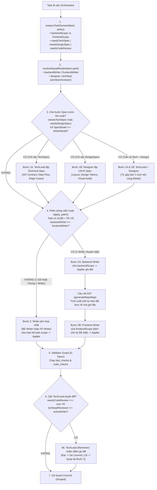

# Đặc Tả Kỹ Thuật: Tối Ưu Hóa Payload, Prefix Cache & Điều Phối Đa Model (v3.1 — Antigravity Parity Edition)

- **Document ID:** `SPEC-RUNTIME-PAYLOAD-V3.1`
- **Phạm vi Áp dụng:**
  - `runtime/provider-gateway.mjs` (HTTP Payload, Multi-Breakpoint Prompt Caching, Thought Signature & Token Accounting)
  - `runtime/session-store.mjs` (Append-Only Trajectory & High-Watermark Epoch Compaction)
  - `runtime/tool-runtime.mjs` (Byte-Bounded Tool Output & Continuation Headers)
  - `runtime/index.mjs` (Bounded Tool Loop, Thinking Stripper & Usage Aggregation)
  - `scripts/lib/risk-policy.mjs` & `scripts/orchestrator.mjs` (Slot-Binding & Auto-Collapse Multi-Model Routing)

---

## 1. Bối Cảnh & Tham Chiếu Thực Nghiệm (Antigravity HTTP POST Reverse Benchmark)

Phân tích thực nghiệm từ một gói tin `POST` thực tế của hệ thống **Google Antigravity** (Step `232`, model `gemini-3.8-flash-n`, tổng dung lượng `674.670 Bytes` / `166.091 tokens` trên cửa sổ `256.000 tokens`) cho thấy cấu trúc chuẩn mực giúp hệ thống duy trì tốc độ phản hồi tức thì và **tỷ lệ trúng bộ nhớ đệm (Cache Hit Rate) đạt 98,6%**:

```text
┌──────────────────────────────────────────────────────────────────────────────┐
│  1. CẤU TRÚC LÁ THƯ REQUEST (674.670 Bytes │ 166.091 Tokens)                 │
├──────────────────────────────────────────────────────────────────────────────┤
│  A. systemInstruction (13 khối cố định) ..  33.587 B │  11.195 tok │   5,0%  │
│  B. contents[232] (Lịch sử Append-Only) .. 580.081 B │ 148.786 tok │  86,0%  │
│     ├─ 14 × user messages (21,8 KB)                                          │
│     ├─ 115 × model messages (103 tool_calls + 12 direct replies)             │
│     └─ 103 × tool_result messages (216,7 KB)                                 │
│  C. tools[17] (3 tool cổng MCP lazy-load)   19.004 B │   6.110 tok │   2,8%  │
│  D. token_budget & usage telemetry .......   6.113 B │          —  │   0,9%  │
│     └─ Thực tế tính phí: new = 2.287 tok │ cached = 163.589 tok (Hit 98,6%) │
└──────────────────────────────────────────────────────────────────────────────┘
```

### 5 Nguyên lý Vàng rút ra từ gói tin thực tế:
1. **Prefix Bất Biến (`System + Tools` = `17.305 tok`):** Toàn bộ `systemInstruction` và danh sách `tools` giữ nguyên thứ tự tuyệt đối giữa mọi lượt gọi.
2. **Lịch sử Append-Only Tuyệt Đối (`232/232 messages`):** Không bao giờ sửa đổi (mutate) nội dung các tin nhắn cũ ở mỗi bước kế tiếp. Nhờ vậy `163.589 / 165.876 tokens` được đọc thẳng từ KV Cache của server.
3. **Thay thế `thinking` text cũ bằng `thought_signature` (`28,5%` dung lượng message):**
   - Trong `115` lượt model trả lời, chỉ giữ lại chữ `thinking` ở các lượt gần nhất (`36/115`), xóa bỏ chữ `thinking` ở `79/115` lượt cũ.
   - Đổi lại, bảo toàn nguyên vẹn `thought_signature` ở cấp `tool_call` (`99,8 KB`) và cấp `message` (`65,6 KB`) để model giữ nguyên trạng thái suy luận mà không phải nghĩ lại từ đầu.
4. **Cắt cứng Kết quả Tool theo Dòng & Byte (`800 dòng / 46.080 Bytes`) kèm Header Chỉ Đường:**
   - Mọi kết quả đọc file đều bị chặn trần kép (số dòng và số byte) để một dòng văn bản nén (minified JS/JSON) không làm nổ tung cửa sổ ngữ cảnh.
   - Khi bị cắt, luôn gắn dòng chỉ dẫn ở đầu (`Partial read... To continue reading, call with start_line=...`) thay vì báo lỗi thất bại.
5. **Đo lường Token minh bạch (`new_input` vs `cached_input` vs `prompt_tokens`):**
   - Tách bạch rõ `new_tokens` (token mới chưa cache) và `cached_tokens` (token đọc từ cache), tổng hợp lên `prompt_tokens = new + cached`.

---

## 2. Chẩn Đoán 6 Điểm Nghẽn Trong `agent-team/` Hiện Tại (Gap Analysis)

Đối chiếu trực tiếp với mã nguồn `agent-team/`, có **6 điểm nghẽn** cần được khắc phục:

| # | Thành phần | Hiện trạng trong `agent-team/` | Hệ quả kỹ thuật |
| :- | :--- | :--- | :--- |
| **G1** | **Cửa sổ trượt phá vỡ Prefix Cache**<br>(`runtime/session-store.mjs`) | Hàm `compactMessagesForContext(messages, maxFullTurns = 2)` dùng mốc cắt động `turns.length - 2`. Ở Turn 3 nó sửa nội dung Turn 1; sang Turn 4 nó sửa nội dung Turn 2; sang Turn 5 nó sửa Turn 3. | **Phá hủy 100% KV Cache của lịch sử hội thoại** ở mọi lượt gọi sau Turn 2 vì chuỗi prefix phía trước bị thay đổi liên tục. |
| **G2** | **Thiếu điểm neo Cache trên khối Ngữ cảnh Lớn**<br>(`runtime/provider-gateway.mjs`) | Chỉ gắn `cache_control: { type: 'ephemeral' }` vào `messages[0]` (`system`, dài ~300–500 token, chưa đạt ngưỡng tối thiểu 1.024 token của Anthropic). Trong khi `messages[1]` chứa `Scoped Files + Repo-Map` (nặng 10k–30k token) và lượt cuối của lịch sử lại không có `cache_control`. | Trong vòng lặp Tool Loop (`maxTurns = 4`), 30k token mã nguồn bị gửi đi gửi lại 4 lần mà không được cache. |
| **G3** | **Làm rơi `thought_signature` & `reasoning_content`**<br>(`runtime/provider-gateway.mjs`, `runtime/index.mjs`) | `parseToolCalls()` và `callModelEndpoint()` chỉ trích xuất `message.content` và `{id, name, arguments}`, làm rơi hoàn toàn `thought_signature`, `signature`, `reasoning_content`, `thinking_blocks`. | Model Thinking (Claude Thinking, Gemini Thinking, DeepSeek Reasoner) bị đứt mạch suy nghĩ khi chuyển từ Turn 1 sang Turn 2 sau khi gọi tool, hoặc bị lỗi 400 trên các cổng yêu cầu signature. |
| **G4** | **`read_file` báo lỗi cứng & thiếu trần Byte**<br>(`runtime/tool-runtime.mjs`) | 1. Khi `end_line - start_line > 300`, `toolReadFile()` trả về `{ ok: false, error: "Maximum read window..." }` làm mất oan 1 lượt tool.<br>2. Không có trần Byte (`MAX_READ_BYTES`), dễ nạp cả trăm KB nếu gặp file minified.<br>3. Thiếu header chỉ đường đọc tiếp. | Tốn lượt tool vô ích khi model ước lượng quá dòng; nguy cơ tràn token khi đọc file 1 dòng siêu dài. |
| **G5** | **Đo lường Token bị gán cứng bằng `0` khi chạy qua Runtime**<br>(`runtime/index.mjs`, `scripts/orchestrator.mjs`) | 1. `runAgent()` chưa cộng dồn `usage` qua các vòng tool.<br>2. `orchestrator.mjs` gán cứng `usage: { prompt_tokens: 0, completion_tokens: 0 }` khi `runAgent()` trả về thành công.<br>3. Nhánh SSE trong `provider-gateway.mjs` chưa đọc `chunk.usage` và `cached_tokens`. | Đồng hồ Token trên Dashboard `:4310` hiển thị `0` khi chạy qua Agent Runtime và không theo dõi được tỷ lệ Cache Hit. |
| **G6** | **Bùng nổ tổ hợp khi phân luồng 1–6 Models trong `Writer Hub`**<br>(`scripts/goal-planner.mjs`, `scripts/lib/risk-policy.mjs`) | Đang để `Router LLM` tự bịa `writer_hub_workflow`, `mode` và `risk_level`. Khi người dùng cấu hình từ 1 model đến 6 models chuyên biệt, chưa có thuật toán cố định để tự động chọn người và tự thu gọn bước thừa. | Task nhỏ bị gắn thêm bước Architect gây chậm; hoặc khi chỉ có 1 model lại tự bắt model đó viết spec cho chính mình đọc. |

---

## 3. Đặc Tả Giải Pháp Chi Tiết (6 Hạng Mục Thực Thi)

### 3.1. Hạng mục 1: Cắt Êm Theo Dòng & Byte + Header Chỉ Đường (`runtime/tool-runtime.mjs`)

Nâng cấp `toolReadFile(repoRoot, args, context)` với 3 chốt chặn:

1. **Hằng số Giới hạn Kép:**
   ```javascript
   export const MAX_READ_LINES = 300;
   export const MAX_READ_BYTES = 32768; // 32 KB hard ceiling per read_file call
   export const MAX_SINGLE_LINE_CHARS = 4096; // Cắt dòng đơn lẻ quá dài (minified files)
   ```
2. **Cơ chế Clamp Êm (Zero-Error Clamping):**
   - Nếu `args.end_line` không truyền hoặc vượt quá `startLine + MAX_READ_LINES - 1`, tự động hạ `effectiveEndLine = Math.min(lines.length, startLine + MAX_READ_LINES - 1)` **mà không bao giờ trả về `ok: false`**.
3. **Cắt theo Trần Byte & Sinh Header Chỉ Đường (`navigation_hint`):**
   - Duyệt từ `startLine` đến `effectiveEndLine`:
     - Nếu 1 dòng dài quá `MAX_SINGLE_LINE_CHARS`, cắt ở `4096` ký tự và nối ` [... line truncated ...]`.
     - Cộng dồn số byte UTF-8; nếu dòng tiếp theo làm vượt quá `MAX_READ_BYTES`, dừng lại ngay ở dòng trước đó (`actualEndLine`).
   - Nếu `actualEndLine < lines.length` hoặc `startLine > 1`:
     - Chèn dòng Header Chỉ Đường lên đầu `content`:
       ```text
       [Showing lines 1-300 of 1430 (12,450 bytes). To continue reading, call read_file with start_line=301]
       ```

---

### 3.2. Hạng mục 2: Bảo Toàn `thought_signature` & Gọt Bỏ `thinking` Cũ (`runtime/provider-gateway.mjs` & `runtime/index.mjs`)

1. **Trong `provider-gateway.mjs` (`parseToolCalls`, `parseSSEResponse`, `callModelEndpoint`):**
   - Khi bóc tách `tool_calls`, giữ lại trường `thought_signature` (hoặc `signature` / `provider_specific_fields`):
     ```javascript
     return {
       id: tc.id || `call_${Date.now()}_${Math.random().toString(36).slice(2, 7)}`,
       name: tc.function?.name || '',
       arguments: parsedArgs,
       ...(tc.thought_signature ? { thought_signature: tc.thought_signature } : {}),
       ...(tc.provider_specific_fields ? { provider_specific_fields: tc.provider_specific_fields } : {})
     };
     ```
   - Ở cấp `message`, trích xuất và trả về thêm:
     - `reasoning_content: message.reasoning_content || message.thinking || ''`
     - `thought_signature: message.thought_signature || message.signature || null`
     - `thinking_blocks: Array.isArray(message.thinking_blocks) ? message.thinking_blocks : null`
2. **Trong `runtime/index.mjs` (Vòng lặp Tool Loop):**
   - Khi đóng gói `assistantMsg` đẩy vào mảng `messages`:
     - Đính kèm lại `thought_signature` và `thinking_blocks` (nếu có) vào `assistantMsg` và từng phần tử trong `assistantMsg.tool_calls` để gửi trả lại ở lượt gọi tool kế tiếp.
     - **Chốt chặn Tương thích Đa Provider:** Tuyệt đối **KHÔNG** gửi ngược chuỗi `reasoning_content` thô vào mảng `messages` của request kế tiếp (vì nhiều cổng API trả lỗi HTTP 400 nếu `assistant` message chứa trường `reasoning_content` không chuẩn); chỉ bảo toàn `thought_signature` và `thinking_blocks` khi provider trả về.
     - Hàm `stripOldInlineThinking(messages, keepRecentTurns = 1)`: Với các lượt `assistant` cũ hơn lượt gần nhất, nếu `content` có chứa thẻ `<think>[\s\S]*?<\/think>`, tự động xóa khối `<think>...</think>` khỏi `content` nhưng **giữ nguyên `thought_signature`** — tái hiện đúng cơ chế tiết kiệm 70% dung lượng suy nghĩ của Antigravity.

---

### 3.3. Hạng mục 3: Lịch Sử `Append-Only` & Nén Theo Chốt (`Epoch Compaction` trong `runtime/session-store.mjs`)

Thay thế cơ chế cửa sổ trượt mỗi lượt (`turns.length - 2`) bằng cơ chế **Append-Only + Nén Theo Ngưỡng (High-Watermark Epoch Compaction)**:

1. **Trong suốt vòng lặp Tool Loop của 1 Task (`runAgent`):**
   - Tuyệt đối **KHÔNG gọi nén lại `messages` giữa các Turn 1 $\rightarrow$ Turn 2 $\rightarrow$ Turn 3 $\rightarrow$ Turn 4**.
   - Mảng `messages` trong suốt 4 turns chỉ được `.push(assistantMsg)` và `.push(toolResultMsg)` (**100% Append-Only**).
2. **Khi nạp lại Session cũ từ đĩa (`compactMessagesForContext`):**
   - Đặt ngưỡng `COMPACTION_HIGH_WATERMARK_TOKENS = 32000` (~110 KB văn bản).
   - **Nếu tổng token ước tính của `session.messages` $\le 32.000$ tokens:** Giữ nguyên **100% nguyên bản Append-Only** (chỉ gọt bỏ thẻ `<think>...</think>` nội tuyến cũ và các bản dump `CURRENT SCOPED FILE CONTENTS:` bị trùng lặp từ những lần retry trước).
   - **Chỉ khi vượt ngưỡng `32.000 tokens`:** Mới thực hiện nén theo lô cố định (Epoch Checkpoint — nén toàn bộ các turn từ đầu đến `turns.length - 4` một lần duy nhất rồi lưu cố định vào `session.messages`), nhờ đó các lượt tiếp theo lại tiếp tục nối đuôi Append-Only trên nền đã nén!

---

### 3.4. Hạng mục 4: Đặt Điểm Neo `Multi-Breakpoint Prompt Caching` (`runtime/provider-gateway.mjs`)

Anthropic Claude và các cổng tương thích qua 9Router hỗ trợ tối đa **4 điểm neo `cache_control: { type: 'ephemeral' }`**, tương ứng với cấu trúc `A (System) + C (Tools) + B (Prefix History)`:

1. **Điểm neo 1 — Cuối danh sách `tools`:**
   - Gắn `cache_control: { type: 'ephemeral' }` vào tool cuối cùng trong mảng `payload.tools` (nếu model là Claude).
2. **Điểm neo 2 — Khối `system` (`messages[0]`):**
   - Giữ nguyên điểm neo trên `messages[0]`.
3. **Điểm neo 3 — Khối Ngữ cảnh Gốc (`messages[1]` — User Task + Scoped Files + Repo-Map):**
   - Trong `orchestrator.mjs`, `messages[1]` chứa toàn bộ `NEIGHBORING CODEBASE SKELETON` và `CURRENT SCOPED FILE CONTENTS` (chiếm 80%–90% tổng lượng token đầu vào).
   - Đặt điểm neo `cache_control: { type: 'ephemeral' }` vào `messages[1]` giúp các vòng gọi Tool thứ 2, 3, 4 trong `runAgent()` đọc thẳng toàn bộ mã nguồn dự án từ bộ nhớ đệm mà không tốn tiền/thời gian nạp lại!

---

### 3.5. Hạng mục 5: Chuẩn Hóa Đo Lường Token (`new`, `cached`, `prompt`, `completion`)

1. **Trong `provider-gateway.mjs` (`normalizeUsage(rawUsage)`):**
   - Trích xuất chuẩn xác từ cả OpenAI format lẫn Anthropic/9Router format:
     ```javascript
     export function normalizeUsage(raw = {}) {
       const cached = Number(
         raw.cache_read_input_tokens
         ?? raw.prompt_tokens_details?.cached_tokens
         ?? raw.cached_tokens
         ?? 0
       );
       const cacheCreation = Number(raw.cache_creation_input_tokens ?? 0);
       const rawInput = Number(raw.prompt_tokens ?? raw.input_tokens ?? 0);
       const completion = Number(raw.completion_tokens ?? raw.output_tokens ?? 0);
       // Nếu provider trả input_tokens tách rời khỏi cache_read_input_tokens, tổng prompt thực = rawInput + cached
       const totalPrompt = raw.cache_read_input_tokens !== undefined
         ? (rawInput + cached + cacheCreation)
         : rawInput;
       const uncachedInput = Math.max(0, totalPrompt - cached);

       return {
         prompt_tokens: totalPrompt,
         uncached_input_tokens: uncachedInput,
         cached_tokens: cached,
         completion_tokens: completion,
         total_tokens: totalPrompt + completion,
         cache_hit_ratio: totalPrompt > 0 ? Number((cached / totalPrompt).toFixed(4)) : 0
       };
     }
     ```
2. **Trong `runtime/index.mjs` & `scripts/orchestrator.mjs`:**
   - Cộng dồn `usage` qua mọi turn trong `runAgent()` và trả về `res.usage`.
   - `orchestrator.mjs` ghi nhận đúng `agentRes.usage` vào `liveStatus.tokens` và `state.metrics`, hiển thị rõ tỷ lệ Cache Hit trong log.

---

### 3.6. Hạng mục 6: Động Cơ Điều Phối Theo Nhu Cầu Task & Đội Ngũ Thực Tế (`Task-Demand × Squad-Roster Engine` — 100% Project-Agnostic)

Giải quyết triệt để 3 bài toán cốt lõi của `Writer Hub` & Pipeline Điều Phối:
1. **100% Độc lập Dự án (`Zero Project-Specific Hardcoding`):** Tuyệt đối không gắn cứng tên thư mục hay công nghệ của bất kỳ dự án cụ thể nào. Mọi quyết định đều dựa trên **Tín hiệu Nhu cầu của Task (`Task Demand`)** và **Năng lực Đội ngũ hiện có trong `team.yaml` (`Squad Roster`)**.
2. **Biết Task Cần Gì (`Task Demand Analysis`):** Tự động nhận diện task thuộc miền Backend/Logic, Frontend/UI, Thiết kế Thị giác (Vision/Mockup), hay Hỗn hợp Đa tầng (`Full-Stack Mixed`), cùng mức độ rủi ro để quyết định có cần bản Đặc tả Kỹ thuật (`Tech Spec`), Đặc tả Giao diện (`UI/UX Spec`), hay Kiểm duyệt Code (`TechLead Diff Review`) hay không.
3. **Biết Đội Ngũ Có Ai Để Gọi Đúng Người (`Roster Matching & Auto-Collapse`):** Hỗ trợ mượt mà mọi tổ hợp cấu hình từ **1 Model** đến **6+ Models** (`Chỉ có Writer`, `Writer + TechLead`, `Writer + Designer`, `Writer + Designer + TechLead`, `Multi-Writer BE/FE + Designer + TechLead + Router`). Không bao giờ gọi thừa chuyên gia khi task không cần, và không bao giờ bắt cùng 1 model tự viết spec hay tự review code của chính mình.

---

#### 3.6.1. Bước 1: Phân Tích Nhu Cầu Của Task (`analyzeTaskDemand` — 0-Token, Độc Lập Ngôn Ngữ)

Trước khi chọn bất kỳ model nào, hệ thống đọc `task` (`scope`, `goal`, `attachments`, `mode`, `risk_level`) và đối chiếu với các mẫu glob phổ quát (có thể ghi đè trong `policy.yaml` dưới khóa `domain_patterns`) để rút trích **Vector Nhu Cầu (`TaskDemand`)**:

- **Mẫu nhận diện Giao diện mặc định (`DEFAULT_FRONTEND_PATTERNS`):**
  `['**/*.html', '**/*.css', '**/*.scss', '**/*.less', '**/*.tsx', '**/*.jsx', '**/*.vue', '**/*.svelte', '**/ui/**', '**/ui_*/**', '**/frontend/**', '**/components/**', '**/views/**', '**/pages/**']`
- **Mẫu nhận diện Kiểm thử mặc định (`DEFAULT_TEST_PATTERNS`):**
  `['**/test/**', '**/tests/**', '**/__tests__/**', '**/*.test.*', '**/*.spec.*', '**/test_*.*']`
- **Phân giỏ `task.scope` (`partitionScopeByDomain`):**
  - `frontendScope`: Các file trong `task.scope` khớp `frontend_patterns`.
  - `backendScope`: Toàn bộ các file logic, dịch vụ, API, cấu hình và test còn lại trong `task.scope`.

| Cờ Nhu Cầu (`TaskDemand`) | Điều kiện kích hoạt tự động (`0-Token`) | Ý nghĩa thực thi |
| :--- | :--- | :--- |
| **`hasBackend`** | `backendScope.length > 0` | Task có can thiệp vào mã nguồn logic, API, dịch vụ, CLI, cơ sở dữ liệu hoặc kiểm thử. |
| **`hasFrontend`** | `frontendScope.length > 0` | Task có can thiệp vào giao diện, bảng kiểu (CSS), bố cục DOM hoặc component hiển thị. |
| **`isCrossDomain`** | `hasBackend && hasFrontend` | Task Hỗn hợp (`Mixed BE + UI`) cần sự ăn khớp hợp đồng dữ liệu giữa Backend và Frontend. |
| **`hasVisualInput`** | `Array.isArray(task.attachments) && task.attachments.length > 0` | Task có đính kèm hình ảnh mockup, wireframe hoặc ảnh chụp màn hình lỗi giao diện. |
| **`needsDesignSpec`** | `hasVisualInput` **HOẶC** (`hasFrontend` **VÀ** (`mode === 'standard'` **HOẶC** `goal` chứa từ khóa thiết kế bố cục/UX/theme/responsive)) | Task cần chuyên gia **`Designer`** thẩm định thị giác hoặc lập đặc tả UI/UX & Design Tokens trước khi code. |
| **`needsTechSpec`** | `mode === 'standard'` **HOẶC** `risk_level ∈ ['high', 'critical']` **HOẶC** `isCrossDomain` | Task cần chuyên gia **`TechLead / Architect`** chốt kiến trúc, chữ ký hàm, luồng dữ liệu và các ca biên trước khi code. |
| **`needsCodeReview`** | `mode === 'standard'` **HOẶC** `risk_level >= review_min_risk_level` **HOẶC** `task.force_ai_review === true` | Sau khi qua trạm `Validator`, bản `git diff` cần được **`TechLead (Reviewer)`** kiểm duyệt chéo. |

---

#### 3.6.2. Bước 2: Nhận Diện Đội Ngũ Hiện Có (`resolveSquadRoster` từ `team.yaml` / Cockpit)

Hệ thống kiểm tra các vai trò đang được bật (`enabled !== false` và có khai báo `model`) trong `team.yaml`:

1. **`backendWriter` (Kỹ sư Backend / Coder chính):**
   - Ưu tiên `roles.backend_writer` $\rightarrow$ `roles.writer.default_model` (hoặc `roles.writer.models[0]`).
2. **`frontendWriter` (Kỹ sư Frontend / UI Coder):**
   - Ưu tiên `roles.frontend_writer` $\rightarrow$ nếu `roles.writer.models` có $\ge 2$ models thì chọn model có năng lực UI/Frontend trong danh sách `roles.writer.models` $\rightarrow$ nếu không có thì kế thừa chính `backendWriter`.
3. **`designer` (Chuyên gia Thiết kế UI/UX & Thị giác):**
   - Khai báo tại `roles.designer`. Chỉ hợp lệ khi `roles.designer.enabled !== false` và có `model`.
4. **`techlead` (Kiến trúc sư Kỹ thuật & Kiểm duyệt viên — hợp nhất `reviewer` / `techlead` / `architect`):**
   - Ưu tiên tìm theo thứ tự:
     - Ở bước **Lập đặc tả kỹ thuật (`Pre-Code Tech Spec`)**: `roles.architect` $\rightarrow$ `roles.techlead` $\rightarrow$ `roles.reviewer` $\rightarrow$ `roles.router`.
     - Ở bước **Duyệt code (`Post-Code Diff Review`)**: `roles.reviewer` $\rightarrow$ `roles.techlead`.

---

#### 3.6.3. Bốn Quy Tắc Bất Biến Chống Lãng Phí & Chống Tự Kỷ (`4 Routing Invariants`)

1. **Quy tắc 1 — Không gọi Chuyên gia trái ngành (`Domain Relevance Rule`):**
   - Nếu `hasFrontend === false` và `hasVisualInput === false` (Task thuần Backend/Logic), **`Designer` tuyệt đối KHÔNG được gọi**, dù người dùng có bật `Designer` trong `team.yaml`.
2. **Quy tắc 2 — Không tự viết Spec cho chính mình đọc (`Anti-Self-Spec Rule`):**
   - Nếu model được chọn làm `TechLead Spec` (hoặc `Designer Spec`) **trùng ID** với model `Writer` sẽ viết code cho giỏ đó (ví dụ đội chỉ có 1 model duy nhất), bước `draft_spec` tương ứng sẽ **tự động được bỏ qua** để không tốn gấp đôi token vô ích.
3. **Quy tắc 3 — Không tự chấm điểm code của chính mình (`Anti-Self-Review Rule`):**
   - Ở trạm `Reviewer Gate` (sau khi `Validator` đã chạy pass test), nếu người dùng không cấu hình `Reviewer / TechLead` **HOẶC** model của `Reviewer` trùng khít với model `Writer` vừa viết đoạn code đó (`reviewerModel === activeWriterModel`), hệ thống **tự động bỏ qua bước gọi AI Reviewer** (trừ khi task ép buộc `force_ai_review: true`). Tránh việc cùng 1 model vừa viết code xong lại tự khen code của mình.
4. **Quy tắc 4 — Gộp bước thông minh khi trùng Model (`Auto-Collapse Rule`):**
   - Nếu một Task hỗn hợp (`Mixed BE + UI`) cần cả `Tech Spec` lẫn `Design Spec`, nhưng `techSpecModel === designSpecModel` (ví dụ cùng là `Claude Sonnet`), hệ thống **tự động gộp làm 1 bước `draft_spec` duy nhất** yêu cầu xuất cả Hợp đồng Kỹ thuật lẫn Đặc tả Giao diện.
   - Nếu Task hỗn hợp có cả `backendScope` và `frontendScope`, nhưng `backendWriter === frontendWriter` (chỉ có 1 model Coder), hệ thống **tự động gộp Bước 2A và Bước 2B thành 1 lượt `apply_patch` duy nhất** trên toàn bộ `task.scope`.

---

#### 3.6.4. Ma Trận Phân Luồng Toàn Diện Cho Mọi Tổ Hợp Đội Ngũ & Loại Task (`Universal Case Matrix`)

Bảng dưới đây quy định chính xác hệ thống sẽ gọi ai, theo thứ tự nào cho mọi cấu hình `team.yaml`:

| Tổ hợp Đội ngũ trong `team.yaml` | Loại Task thực tế | Luồng chạy trong `Writer Hub` (Trước Validator) | Trạm `Reviewer Gate` (Sau Validator) |
| :--- | :--- | :--- | :--- |
| **Tổ hợp 1: Chỉ có `[Writer]`**<br>*(1 Model duy nhất)* | **Mọi loại Task**<br>*(BE, UI, hoặc BE + UI)* | **1 bước duy nhất:**<br>`[Writer sửa toàn bộ task.scope]`<br>*(Bỏ qua Spec theo Quy tắc 2)*. | **Bỏ qua (Skip)**<br>*(Theo Quy tắc 3: Không tự review chính mình; dùng 0-token Validator)*. |
| **Tổ hợp 2: `[Writer + TechLead]`**<br>*(Không có Designer)* | **Task Nhỏ (`mode: quick`, `risk: low`)** | **1 bước:** `[Writer sửa task.scope]`. | **Bỏ qua (Skip)** *(Rủi ro thấp)*. |
| **Tổ hợp 2: `[Writer + TechLead]`**<br>*(Không có Designer)* | **Task Lớn / Rủi ro cao / Mixed**<br>*(BE, UI, hoặc BE + UI)* | **2 bước:**<br>1. `[TechLead viết Tech Spec & Contract]`<br>2. `[Writer code theo Spec]`. | **Chạy `TechLead Review`**<br>*(TechLead chấm điểm `git diff` theo 4 tiêu chí)*. |
| **Tổ hợp 3: `[Writer + Designer]`**<br>*(Không có TechLead/Reviewer)* | **Task Thuần Backend / Logic**<br>(`hasFrontend === false`) | **1 bước:** `[Writer sửa backendScope]`<br>*(Designer nghỉ theo Quy tắc 1 vì task không có UI)*. | **Bỏ qua (Skip)**<br>*(Không có TechLead để review backend diff)*. |
| **Tổ hợp 3: `[Writer + Designer]`**<br>*(Không có TechLead/Reviewer)* | **Task Giao diện UI / Có ảnh Mockup**<br>(`hasFrontend === true`) | **2 bước:**<br>1. `[Designer thẩm định & viết UI/UX Spec]`<br>2. `[Writer code giao diện theo UI Spec]`. | **Bỏ qua (Skip)**<br>*(Không có TechLead; dùng Validator kiểm tra DOM/Syntax)*. |
| **Tổ hợp 3: `[Writer + Designer]`**<br>*(Không có TechLead/Reviewer)* | **Task Hỗn hợp (`BE + UI`)** | **2 bước:**<br>1. `[Designer viết UI/UX & State Spec]`<br>2. `[Writer code toàn bộ task.scope]`. | **Bỏ qua (Skip)**. |
| **Tổ hợp 4: `[Writer + Designer + TechLead]`**<br>*(Đủ bộ 3: Coder, Thiết kế, TechLead)* | **Task Thuần Backend / Logic** | **2 bước (nếu `standard`):**<br>1. `[TechLead viết Tech Spec]` *(Designer nghỉ)*<br>2. `[Writer sửa backendScope]`. | **Chạy `TechLead Review`** *(nếu `standard` hoặc `risk >= high`)*. |
| **Tổ hợp 4: `[Writer + Designer + TechLead]`**<br>*(Đủ bộ 3: Coder, Thiết kế, TechLead)* | **Task Thuần Giao diện UI** | **2 bước:**<br>1. `[Designer viết UI/UX Spec]`<br>2. `[Writer sửa frontendScope]`. | **Chạy `TechLead Review`** *(nếu `standard` hoặc `risk >= high` để kiểm tra an toàn DOM/XSS)*. |
| **Tổ hợp 4: `[Writer + Designer + TechLead]`**<br>*(Đủ bộ 3: Coder, Thiết kế, TechLead)* | **Task Hỗn hợp (`BE + UI`)** | - **Bước 1 (Spec):** `TechLead` chốt API/State Contract + `Designer` chốt UI/UX Spec *(Gộp làm 1 nếu trùng model)*.<br>- **Bước 2 (Code):** `Writer` sửa `task.scope`. | **Chạy `TechLead Review`** *(Kiểm duyệt đồng bộ BE & UI trên `git diff`)*. |
| **Tổ hợp 5: `[BE Writer + FE Writer + Designer + TechLead]`**<br>*(4–6+ Models chuyên biệt)* | **Task Hỗn hợp (`BE + UI`)** | - **Bước 1:** `TechLead` (+ `Designer`) lập Spec chung.<br>- **Bước 2A:** `BE Writer` sửa `backendScope` $\rightarrow$ Ghi đĩa.<br>- **Cầu nối AST:** Trích xuất chữ ký hàm thực tế từ `backendScope` vừa ghi đĩa.<br>- **Bước 2B:** `FE Writer` sửa `frontendScope` (nhận Spec + chữ ký BE thực tế) $\rightarrow$ Ghi đĩa. | **Chạy `TechLead Review`** *(Kiểm duyệt toàn cục sau khi cả BE và FE đã pass Validator)*. |

---

#### 3.6.5. Sơ Đồ Luồng Quyết Định Tổng Thể (`End-to-End Task Pipeline Decision Flow`)



---

#### 3.6.6. Thiết Kế Chi Tiết Bộ Hàm Điều Phối Trong `scripts/lib/risk-policy.mjs`

```javascript
export const DEFAULT_FRONTEND_PATTERNS = [
  '**/*.html',
  '**/*.htm',
  '**/*.css',
  '**/*.scss',
  '**/*.sass',
  '**/*.less',
  '**/*.tsx',
  '**/*.jsx',
  '**/*.vue',
  '**/*.svelte',
  '**/ui/**',
  '**/ui_*/**',
  '**/frontend/**',
  '**/client/**',
  '**/components/**',
  '**/views/**',
  '**/pages/**'
];

// Unicode-safe boundary regex (hỗ trợ chuẩn NFC cho tiếng Việt có dấu + tiếng Anh)
const UI_INTENT_REGEX = /(?<![\p{L}\p{N}_])(ui|ux|layout|css|style|theme|dark\s*mode|light\s*mode|responsive|modal|button|dialog|animation|visual|giao\s*diện|bố\s*cục|màu\s*sắc|hiển\s*thị)(?![\p{L}\p{N}_])/iu;

export function matchesDomainPattern(filePath = '', pattern = '') {
  const cleanFile = String(filePath || '').trim().replace(/\\/g, '/').replace(/^\/+/, '');
  const cleanPat = String(pattern || '').trim().replace(/\\/g, '/').replace(/^\/+/, '');
  if (!cleanFile || !cleanPat) return false;

  let regexStr = cleanPat
    .replace(/^\*\*\//, '__GLOB_PREFIX__')
    .replace(/\/\*\*$/, '__GLOB_SUFFIX__')
    .replace(/\/\*\*\//g, '__GLOB_MID_DIRS__')
    .replace(/\*\*/g, '__GLOB_ALL__')
    .replace(/\*/g, '__GLOB_ONE__')
    .replace(/[.+^${}()|[\]\\]/g, '\\$&')
    .replace(/__GLOB_PREFIX__/g, '(?:^|.*/)')
    .replace(/__GLOB_SUFFIX__/g, '(?:/.*|$)')
    .replace(/__GLOB_MID_DIRS__/g, '/(?:.*/)?')
    .replace(/__GLOB_ALL__/g, '.*')
    .replace(/__GLOB_ONE__/g, '[^/]*');

  try {
    return new RegExp(`^${regexStr}$`, 'i').test(cleanFile);
  } catch {
    return false;
  }
}

/**
 * 1. Chia task.scope thành 2 giỏ độc lập dự án: frontendScope và backendScope.
 */
export function partitionScopeByDomain(scope = [], policyConfig = {}) {
  const customPatterns = policyConfig?.policy?.domain_patterns?.frontend
    || policyConfig?.domain_patterns?.frontend;
  const frontendPatterns = Array.isArray(customPatterns) && customPatterns.length > 0
    ? customPatterns
    : DEFAULT_FRONTEND_PATTERNS;

  const frontendScope = [];
  const backendScope = [];

  for (const rawFile of scope) {
    const file = String(rawFile || '').trim().replace(/\\/g, '/');
    if (!file) continue;
    const isFrontend = frontendPatterns.some(pat => matchesDomainPattern(file, pat));
    if (isFrontend) {
      frontendScope.push(file);
    } else {
      backendScope.push(file);
    }
  }

  return { backendScope, frontendScope };
}

/**
 * 2. Phân tích nhu cầu thực sự của Task (0-Token, độc lập dự án).
 *    Sử dụng max(declared, computed) cho cả riskLevel và mode để chống LLM hạ cấp rủi ro.
 */
export function analyzeTaskDemand(task = {}, policyConfig = {}) {
  const policy = policyConfig?.policy || policyConfig || {};
  const { backendScope, frontendScope } = partitionScopeByDomain(task.scope || [], policy);
  const hasBackend = backendScope.length > 0;
  const hasFrontend = frontendScope.length > 0;
  const isCrossDomain = hasBackend && hasFrontend;

  // Hiệu lực rủi ro = max(declared, computed) qua resolveEffectiveRisk(task)
  const riskLevel = resolveEffectiveRisk(task);

  // Hiệu lực mode: nếu declared là 'consult' thì giữ nguyên; nếu risk >= high hoặc isCrossDomain thì tự nâng từ 'quick' lên 'standard'
  const rawMode = String(task.mode || '').toLowerCase();
  const computedMode = resolveTaskMode(task, policy);
  let mode = rawMode === 'consult'
    ? 'consult'
    : ((rawMode === 'standard' || computedMode === 'standard' || isCrossDomain || riskLevel === 'high' || riskLevel === 'critical')
        ? 'standard'
        : 'quick');

  const hasVisualInput = Array.isArray(task.attachments) && task.attachments.length > 0;
  const goalText = `${task.title || ''} ${task.goal || ''}`.normalize('NFC');
  const hasUiIntent = UI_INTENT_REGEX.test(goalText);

  const needsDesignSpec = mode !== 'consult' && (
    hasVisualInput ||
    (hasFrontend && (mode === 'standard' || hasUiIntent || riskLevel === 'high' || riskLevel === 'critical'))
  );

  const needsTechSpec = mode !== 'consult' && (
    mode === 'standard' ||
    isCrossDomain ||
    riskLevel === 'high' ||
    riskLevel === 'critical'
  );

  const minReviewRisk = String(policy.approval_gates?.review_min_risk_level || 'high').toLowerCase();
  const minRank = RISK_LEVEL_RANK[minReviewRisk] || RISK_LEVEL_RANK.high;
  const taskRank = RISK_LEVEL_RANK[riskLevel] || RISK_LEVEL_RANK.low;
  const meetsRiskThreshold = taskRank >= minRank;
  const needsCodeReview = mode !== 'consult' && (
    Boolean(task.force_ai_review) ||
    mode === 'standard' ||
    meetsRiskThreshold
  );

  return {
    mode,
    riskLevel,
    backendScope,
    frontendScope,
    hasBackend,
    hasFrontend,
    isCrossDomain,
    hasVisualInput,
    hasUiIntent,
    needsDesignSpec,
    needsTechSpec,
    needsCodeReview
  };
}

/**
 * 3. Trích xuất năng lực đội ngũ hiện có từ team.yaml.
 */
export function resolveSquadRoster(teamConfig = {}, task = {}) {
  const roles = teamConfig?.roles || {};
  const getRoleModel = (roleCfg) => {
    if (!roleCfg || roleCfg.enabled === false) return null;
    return roleCfg.default_model
      || roleCfg.model
      || (Array.isArray(roleCfg.models) && roleCfg.models.length > 0 ? roleCfg.models[0] : null);
  };

  const primaryWriterModel = task.model || getRoleModel(roles.backend_writer) || getRoleModel(roles.writer);

  // Tìm Frontend Writer chuyên biệt:
  // Ưu tiên 1: roles.frontend_writer
  // Ưu tiên 2: Model trong roles.writer.models có capability frontend/vision (VD: gemini/claude/sonnet)
  // Ưu tiên 3: Phần tử thứ 2 trong roles.writer.models
  let frontendWriterModel = task.model || getRoleModel(roles.frontend_writer) || null;
  let frontendWriterRole = roles.frontend_writer?.enabled !== false && getRoleModel(roles.frontend_writer)
    ? 'frontend_writer'
    : 'writer';

  if (!frontendWriterModel && Array.isArray(roles.writer?.models) && roles.writer.models.length > 1) {
    const uiCapableCandidate = roles.writer.models.find(
      m => m !== primaryWriterModel && /(gemini|claude|sonnet|gpt-4o|vision|frontend|ui)/i.test(String(m))
    );
    frontendWriterModel = uiCapableCandidate || roles.writer.models.find(m => m !== primaryWriterModel) || roles.writer.models[1];
  }
  if (!frontendWriterModel) {
    frontendWriterModel = primaryWriterModel;
  }

  const designerModel = getRoleModel(roles.designer);

  // TechLead cho bước Pre-Code Spec (ưu tiên architect -> techlead -> reviewer -> router)
  let techSpecRole = null;
  let techSpecModel = null;
  for (const candidate of ['architect', 'techlead', 'reviewer', 'router']) {
    const m = getRoleModel(roles[candidate]);
    if (m) {
      techSpecRole = candidate;
      techSpecModel = m;
      break;
    }
  }

  // TechLead cho bước Post-Code Diff Review (chỉ nhận reviewer hoặc techlead thực thụ)
  let reviewerRole = null;
  let reviewerModel = null;
  for (const candidate of ['reviewer', 'techlead']) {
    const m = getRoleModel(roles[candidate]);
    if (m) {
      reviewerRole = candidate;
      reviewerModel = m;
      break;
    }
  }

  return {
    backendWriterModel: primaryWriterModel,
    frontendWriterModel,
    frontendWriterRole,
    designerModel,
    techSpecRole,
    techSpecModel,
    reviewerRole,
    reviewerModel
  };
}

/**
 * 4. Tự động lắp ráp luồng chạy của Writer Hub dựa trên (TaskDemand × SquadRoster).
 */
export function resolveWriterHubWorkflow(task = {}, teamConfig = {}, policyConfig = {}, preset = 'auto') {
  const demand = analyzeTaskDemand(task, policyConfig);
  if (demand.mode === 'consult') return [];

  const roster = resolveSquadRoster(teamConfig, task);
  if (!roster.backendWriterModel) return [];

  const workflow = [];
  let stepCounter = 1;
  const generatedSpecArtifacts = [];

  // Tập các model Coder sẽ tham gia viết code ở task này
  const activeWriterModels = new Set([
    ...(demand.hasBackend || !demand.hasFrontend ? [roster.backendWriterModel] : []),
    ...(demand.hasFrontend ? [roster.frontendWriterModel] : [])
  ]);
  const isSameAsAllWriters = (modelId) => Boolean(modelId && activeWriterModels.size === 1 && activeWriterModels.has(modelId));

  // --- BƯỚC 1: XÁC ĐỊNH CÁC BƯỚC LẬP ĐẶC TẢ (PRE-CODE SPECS) ---
  if (preset !== 'fast') {
    const wantTechSpec = preset === 'architect' || (demand.needsTechSpec && (demand.hasBackend || !roster.designerModel));
    const wantDesignSpec = demand.needsDesignSpec;

    const canRunTechSpec = wantTechSpec && roster.techSpecModel && !isSameAsAllWriters(roster.techSpecModel);
    const canRunDesignSpec = wantDesignSpec && roster.designerModel && !isSameAsAllWriters(roster.designerModel);

    if (canRunTechSpec && canRunDesignSpec) {
      if (roster.techSpecModel === roster.designerModel) {
        // Auto-Collapse: TechLead và Designer dùng chung 1 model -> Gộp làm 1 lượt gọi Spec duy nhất
        const combinedArtifact = `artifacts/${task.task_id || 'task'}_unified_spec.md`;
        workflow.push({
          step: stepCounter++,
          role: roster.techSpecRole,
          model: roster.techSpecModel,
          action: 'draft_spec',
          spec_focus: 'unified_tech_and_ui',
          output_artifact: combinedArtifact,
          allow_skip_spec: preset !== 'architect' && !demand.hasVisualInput
        });
        generatedSpecArtifacts.push(combinedArtifact);
      } else {
        // Chạy tuần tự: TechLead chốt hợp đồng dữ liệu -> Designer nhận hợp đồng đó (qua inputs) để chốt giao diện UI/UX
        let techArtifact = null;
        if (demand.hasBackend || demand.needsTechSpec) {
          techArtifact = `artifacts/${task.task_id || 'task'}_tech_spec.md`;
          workflow.push({
            step: stepCounter++,
            role: roster.techSpecRole,
            model: roster.techSpecModel,
            action: 'draft_spec',
            spec_focus: 'architecture_and_contracts',
            output_artifact: techArtifact,
            allow_skip_spec: preset !== 'architect'
          });
          generatedSpecArtifacts.push(techArtifact);
        }
        const designArtifact = `artifacts/${task.task_id || 'task'}_design_spec.md`;
        workflow.push({
          step: stepCounter++,
          role: 'designer',
          model: roster.designerModel,
          action: 'draft_spec',
          spec_focus: 'ui_ux_and_visual_audit',
          inputs: techArtifact ? [techArtifact] : [],
          output_artifact: designArtifact,
          allow_skip_spec: !demand.hasVisualInput
        });
        generatedSpecArtifacts.push(designArtifact);
      }
    } else if (canRunDesignSpec) {
      // Chỉ có Designer (hoặc task thuần UI): Gọi Designer viết UI/UX Spec
      const designArtifact = `artifacts/${task.task_id || 'task'}_design_spec.md`;
      workflow.push({
        step: stepCounter++,
        role: 'designer',
        model: roster.designerModel,
        action: 'draft_spec',
        spec_focus: 'ui_ux_and_visual_audit',
        output_artifact: designArtifact,
        allow_skip_spec: !demand.hasVisualInput
      });
      generatedSpecArtifacts.push(designArtifact);
    } else if (canRunTechSpec) {
      // Chỉ có TechLead/Architect (hoặc task thuần Backend): Gọi TechLead viết Tech Spec
      const techArtifact = `artifacts/${task.task_id || 'task'}_tech_spec.md`;
      workflow.push({
        step: stepCounter++,
        role: roster.techSpecRole,
        model: roster.techSpecModel,
        action: 'draft_spec',
        spec_focus: 'architecture_and_contracts',
        output_artifact: techArtifact,
        allow_skip_spec: preset !== 'architect'
      });
      generatedSpecArtifacts.push(techArtifact);
    }
  }

  // --- BƯỚC 2: XÁC ĐỊNH CÁC BƯỚC VIẾT CODE (APPLY_PATCH BUCKETS) ---
  const canMergePatch = !demand.hasBackend || !demand.hasFrontend || (roster.backendWriterModel === roster.frontendWriterModel);

  if (canMergePatch) {
    const isPureFrontend = demand.hasFrontend && !demand.hasBackend;
    workflow.push({
      step: stepCounter++,
      role: isPureFrontend ? roster.frontendWriterRole : 'writer',
      model: isPureFrontend ? roster.frontendWriterModel : roster.backendWriterModel,
      domain: isPureFrontend ? 'frontend' : (demand.isCrossDomain ? 'fullstack' : 'backend'),
      action: 'apply_patch',
      sub_scope: task.scope || [],
      inputs: [...generatedSpecArtifacts]
    });
  } else {
    // Task hỗn hợp có cả Backend lẫn Frontend VÀ có 2 model Coder chuyên biệt:
    // Bước 2A: Backend Writer sửa backendScope trước
    workflow.push({
      step: stepCounter++,
      role: 'writer',
      model: roster.backendWriterModel,
      domain: 'backend',
      action: 'apply_patch',
      sub_scope: demand.backendScope,
      inputs: [...generatedSpecArtifacts]
    });
    // Bước 2B: Frontend Writer sửa frontendScope nối tiếp (kèm chữ ký AST thực tế từ backendScope)
    workflow.push({
      step: stepCounter++,
      role: roster.frontendWriterRole,
      model: roster.frontendWriterModel,
      domain: 'frontend',
      action: 'apply_patch',
      sub_scope: demand.frontendScope,
      inject_updated_repo_map_from: demand.backendScope,
      inputs: [...generatedSpecArtifacts]
    });
  }

  return workflow;
}
```

#### 3.6.7. Điều Kiện Kích Hoạt Trạm `Reviewer Gate` Chống Tự Chấm Điểm (`shouldRunReviewerGate`)

Cập nhật hàm `shouldRunReviewerGate(task, policyConfig, teamRoles, activeWriterModel)` trong `scripts/lib/risk-policy.mjs`:
1. Kiểm tra `demand.needsCodeReview` (`mode === 'standard'` hoặc `risk_level >= review_min_risk_level` hoặc `force_ai_review === true`).
2. Kiểm tra trong `teamRoles` có tồn tại `reviewer` (hoặc `techlead`) đang bật (`enabled !== false`) và có `model` hợp lệ hay không.
3. **Chốt chặn Anti-Self-Review:** Nếu `reviewerModel === activeWriterModel` và `!task.force_ai_review`, tự động trả về `false` (bỏ qua bước gọi AI Reviewer, ghi log: `[Reviewer] Skipped self-review because reviewer model matches active writer model`) để tiết kiệm token và dựa vào bộ test 0-token của `Validator`.

---

## 4. Lộ Trình Triển Khai Nguyên Tử (4 Batches)

| Batch | Phạm vi (`scope`) | Nội dung thực thi & Tiêu chí nghiệm thu (`acceptance_criteria`) |
| :--- | :--- | :--- |
| **Batch A**<br>*(Tool & Signature)* | `runtime/tool-runtime.mjs`<br>`runtime/provider-gateway.mjs`<br>`scripts/test-runtime-v3.mjs` | - `toolReadFile`: Clamp êm 300 dòng, trần `MAX_READ_BYTES = 32768`, cắt dòng đơn `> 4096 chars`, thêm Header Chỉ Đường.<br>- `provider-gateway.mjs`: Bảo toàn `thought_signature`, `reasoning_content`, `thinking_blocks` và thêm hàm `normalizeUsage()`. |
| **Batch B**<br>*(Append-Only & Cache)* | `runtime/session-store.mjs`<br>`runtime/index.mjs`<br>`runtime/provider-gateway.mjs` | - Giữ `messages` Append-Only 100% trong suốt vòng lặp Tool Loop; chỉ nén theo ngưỡng `32.000 tokens`.<br>- Gọt bỏ thẻ `<think>...</think>` cũ trong khi giữ `thought_signature`.<br>- Đặt điểm neo `cache_control: { type: 'ephemeral' }` lên `tools`, `system`, và `messages[1]`.<br>- Cộng dồn `usage` thật trả về từ `runAgent()`. |
| **Batch C**<br>*(Task-Demand × Squad-Roster Engine)* | `scripts/lib/risk-policy.mjs`<br>`scripts/goal-planner.mjs`<br>`scripts/orchestrator.mjs`<br>`roles/router.md` | - Thêm `partitionScopeByDomain()`, `analyzeTaskDemand()`, `resolveSquadRoster()`, `resolveWriterHubWorkflow()` và chốt chặn `Anti-Self-Review` vào `risk-policy.mjs` (100% độc lập dự án).<br>- Làm sạch `roles/router.md` khỏi các đường dẫn đặc thù dự án; nối `sub_scope`, cầu nối AST và `agentRes.usage` thật vào `orchestrator.mjs`. |
| **Batch D**<br>*(Cockpit Preset Control)* | `ui/index.html`<br>`scripts/dashboard.mjs`<br>`scripts/test-cockpit.mjs` | - Thêm bộ chọn Preset trên Cockpit (`🤖 Auto Policy`, `⚡ Fast 1-Step Coder`, `🏛️ Architect Spec + Coder`, `🔍 Consult Only`) và hiển thị tỷ lệ `Cache Hit %` trên thanh Top Bar. |
